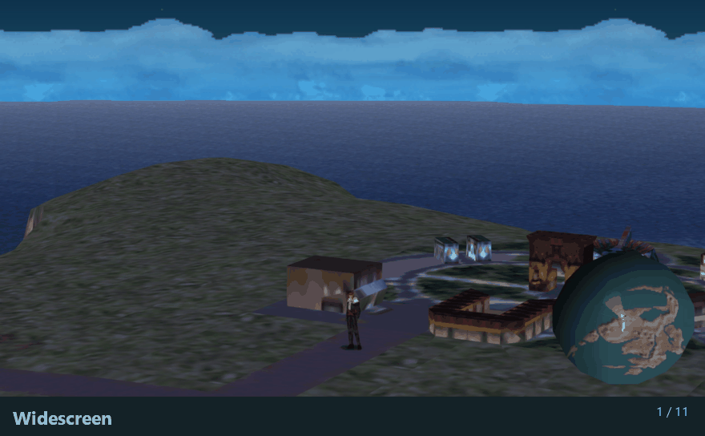
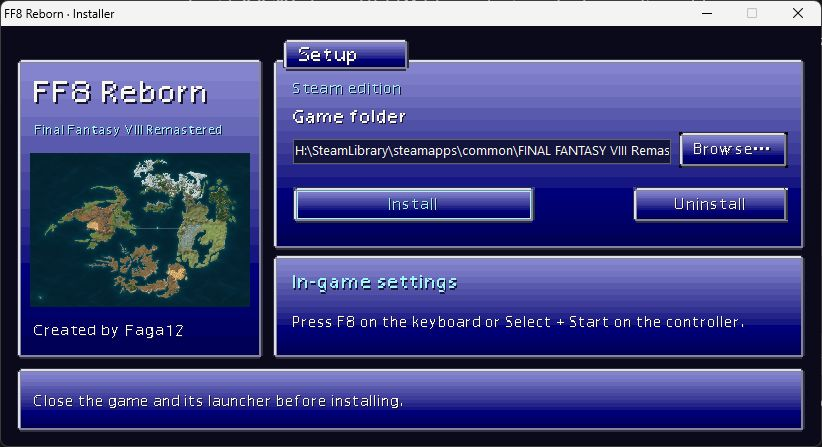
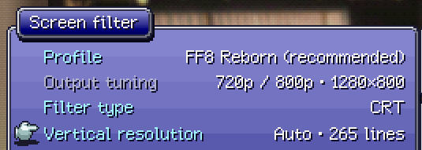

# FF8 Reborn

**[Descargar para Windows](https://github.com/Faga250885/FF8-Reborn/releases/latest/download/FF8-Reborn-Setup.exe)** · **[Descargar para Steam Deck](https://github.com/Faga250885/FF8-Reborn/releases/download/v1.4.0-deck.10/FF8-Reborn-Deck-Setup)** · [Read in English](README.md) · [Galería de capturas](docs/GALERIA.md)

> [!WARNING]
> **Steam Deck sigue en desarrollo.** Las pruebas de juego en una Deck física confirmaron **30 FPS estables** en batallas, ciudades y mapamundi al elegir la opción de 30 FPS. **El próximo objetivo son los 60 FPS.** El desarrollo continuará a medida que haya tiempo disponible. Todavía no hay fecha para ese modo.

FF8 Reborn es un mod visual gratuito para **FINAL FANTASY VIII Remastered** de Steam. Puedes elegir la cadencia original del juego o apuntar a 30 FPS en Steam Deck y a 60 o 120 FPS en Windows. También puedes ampliar la cámara de batallas y mapamundi y ajustar cómo se integran los personajes en los fondos prerenderizados. Los cambios se pueden probar mientras juegas. El menú y el instalador están en inglés.

**En desarrollo.** Si encuentras un fallo, [abre un reporte en GitHub](https://github.com/Faga250885/FF8-Reborn/issues/new?template=bug.yml) o añade tus observaciones a una incidencia existente. Puedes escribir en español.

## Novedades

- **Controles del filtro.** Izquierda y derecha ajustan los nueve controles de porcentaje de 10 en 10 con el teclado o el mando.
- **Difuminado lateral.** Se corrigió la línea oscura que aparecía entre el margen izquierdo y el escenario prerenderizado a 1280×800. El difuminado ahora se alinea con el borde que dibuja el juego.
- **Actualizaciones desde Windows y Steam Deck.** Al iniciar el juego, FF8 Reborn consulta una vez el canal de su plataforma. Si hay una versión nueva, aparece un aviso arriba a la izquierda durante diez segundos y se desvanece en dos. Abre el menú con **F8** o **View + Menu** para ver la versión instalada y la disponible. Elige **Download update** cuando quieras instalarla.
- **Filtros adaptados a tu resolución.** El mismo perfil ajusta el muestreo y la rejilla CRT para Steam Deck a 720p/800p, Full HD a 1080p, QHD a 1440p y 4K a 2160p. **Screen filter → Auto tuning** muestra la resolución activa. Cada perfil tiene su propia intensidad de **Motion blur**, ajustable del 0 % al 100 % en pasos de 10.
- **Rendimiento en Steam Deck.** El modo de 30 FPS usa los cuadros nativos en ciudades y mapamundi e interpola las batallas. Las pruebas de juego en una Deck física confirmaron 30 FPS estables en esas escenas. La versión de Deck sigue siendo experimental y el objetivo de desarrollo es llegar a 60 FPS. Windows también incorpora parte de las optimizaciones de renderizado.
- **Batallas y transiciones en pantalla ancha.** Los destellos llegan a ambos bordes incluso cuando el juego los dibuja por partes. Lo comprobamos en Galbadia con «¡Ángelo al ataque!» de Rinoa. Las pantallas de experiencia, objetos y puntos de habilidad aprovechan el alto disponible y dejan espacio para las ayudas activas. La escena conserva su tamaño al entrar a Triple Triad. Al mover la cámara en batalla, la interpolación comprueba si se forman triángulos que unen combatientes distintos.

En 66 pares de cuadros de batalla grabados, la comprobación detectó triángulos estirados en 21 pares con la versión anterior y en cero tras el cambio. Se conservó el movimiento interpolado del 99,1 % de los vértices que ya lo tenían. Los paneles de experiencia y objetos se midieron en una batalla real a 2560 × 1440.

## Video del mod en acción

[Ver la demostración de FF8 Reborn en YouTube](https://www.youtube.com/watch?v=dBUX5gA7oKM).

## Funciones generales

[Ver las capturas, la medición de FPS y los ejemplos a tamaño completo](docs/GALERIA.md#features).

## Steam Deck (SteamOS, experimental)

| Cadencia | Ciudades y mapamundi | Batallas |
| --- | --- | --- |
| **Original** (predeterminada) | El juego dibuja a su ritmo habitual, normalmente unos 30 FPS. | El juego muestra el combate a su ritmo habitual, normalmente unos 15 FPS. |
| **30 FPS** | Usa los cuadros que dibuja el propio juego al mismo ritmo que en Original, también en pantalla ancha. | Interpola el movimiento entre poses compatibles de la animación original de 15 FPS para mostrar una imagen cada 33,3 ms. Los ataques y sus ventanas de entrada siguen el reloj del juego. |

Los menús y las cinemáticas conservan su cadencia original. En cambios de plano y cuadros de combate que no se puedan emparejar de forma fiable, puede mantenerse la imagen original. En una escena grabada con seis personajes, el mod evitó 414 de 447 copias de geometría en un cuadro y conservó la imagen completa.

En una batalla grabada de 42 segundos a 1280 × 800 en Windows, la versión 1.4.0-deck.4 envió 30,00 cuadros/s. Al subir a 53 ms el trabajo simulado por cada ciclo de combate, envió 29,51 cuadros/s y el percentil 99 del intervalo entre imágenes llegó a 52,39 ms.

### Instalar o actualizar en Steam Deck

Si tienes la versión **1.4.0-deck.1** o posterior, pulsa **View + Menu → Check for updates → Download update**. Cuando aparezca **Update ready**, cierra FFVIII y su lanzador y vuelve a abrir el juego. Si ya tenías seleccionado **Original**, se conserva. Para instalar por primera vez, sigue estos pasos.

1. Instala **FINAL FANTASY VIII Remastered** en Steam. Cierra el juego y su lanzador.
2. Cambia al modo Escritorio y descarga [FF8-Reborn-Deck-Setup](https://github.com/Faga250885/FF8-Reborn/releases/download/v1.4.0-deck.10/FF8-Reborn-Deck-Setup).
3. En Dolphin, haz clic derecho sobre el archivo. En **Propiedades → Permisos**, marca **Es ejecutable** y pulsa **Aceptar**.
4. Abre el archivo con doble clic y pulsa **Install**. Cuando termine, vuelve al modo Juego y abre FFVIII desde Steam. Pulsa **Vista + Menú** a la vez para abrir los ajustes del mod.

El instalador reconoce las bibliotecas de Steam, incluidas las de la microSD. Si te pide localizar una biblioteca, elige la carpeta que contiene `steamapps`. Para quitar el mod, cierra el juego, abre de nuevo el instalador y elige **Uninstall**. La interfaz usa Python 3.8 o superior y Zenity. También está disponible el [instalador de línea de comandos](https://github.com/Faga250885/FF8-Reborn/releases/download/v1.4.0-deck.10/FF8-Reborn-Deck.pyz).

Para usar solo los filtros, abre el panel del mod con **Vista + Menú**. Selecciona **Original** en **Frame rate**, **Original (4:3)** en **Aspect ratio** y **Original** en **Full-screen map**. Después elige el filtro gráfico que prefieras.

## GOG para Windows

El instalador reconoce la edición GOG. Si encuentra ambas tiendas, permite elegir la copia. El motor de GOG 1.0.3 difiere del de Steam y su instalación del mod está pendiente de adaptación y pruebas.

## Requisitos para Windows

FF8 Reborn aún no tiene una GPU mínima medida para 60 o 120 FPS. A 120 FPS, la CPU y la GPU disponen de unos 8,3 ms por cuadro. Influyen la resolución y la complejidad de la escena. En una prueba de diez segundos en el mapamundi a 2560 × 1440, un Ryzen 5 7600X con una RTX 5070 promedió 118,2 FPS mostrados en pantalla. [Medición de FPS](docs/GALERIA.md#frame-rate)

- Un PC con Windows y la cuenta de Steam propietaria de [FINAL FANTASY VIII Remastered (app 1026680)](https://store.steampowered.com/app/1026680/FINAL_FANTASY_VIII__REMASTERED/).
- La edición compatible de Steam para Windows con `FFVIII_EFIGS.dll`. El instalador comprueba el motor y la DLL de audio original. La edición de PC de 2013 y la de PlayStation usan otros motores.
- Inicia el juego desde Steam. Al arrancar, el mod comprueba la aplicación, la licencia y la cuenta propietaria. Una copia prestada o de fin de semana gratuito no activa el mod. La descarga contiene únicamente el mod.
- Para ver 120 FPS, usa una pantalla de al menos 120 Hz y selecciona esa frecuencia en Windows. Los cuadros que llegan a pantalla dependen de la escena, la GPU y el monitor.

## Instalar y jugar

1. Instala el juego en Steam y cierra tanto FFVIII como su lanzador.
2. Descarga y ejecuta **[FF8-Reborn-Setup.exe](https://github.com/Faga250885/FF8-Reborn/releases/latest/download/FF8-Reborn-Setup.exe)**. Este instalador contiene el mod completo. Puedes usarlo sin un gestor de mods ni Lossless Scaling.
3. Revisa **Game folder**. Si hace falta, usa **Browse** y elige la carpeta que abre Steam desde **Administrar → Ver archivos locales**.
4. Pulsa **Install**. El instalador conserva una copia de la DLL de audio original.
5. Abre el juego desde Steam. Pulsa **F8** o **Select + Start** para abrir el menú del mod.

En una instalación nueva de Windows, el mod apunta a **60 FPS** si el monitor del juego está configurado a 60 Hz o menos, y a **120 FPS** si Windows informa más de 60 Hz. Si Windows no informa la frecuencia, usa 60 FPS. Puedes elegir otra cadencia en el menú.

Windows 1.4.1 aprovecha una mejora de Steam Deck que evita repetir ajustes de OpenGL al dibujar el juego. En nueve grabaciones de ciudades, mapamundi y batallas, los 324 cuadros comparados coincidieron en color, profundidad y esténcil. En una batalla a 1080p con una GeForce RTX 5070, el tiempo mediano para volver a dibujar un cuadro con un búfer de vértices bajó de 2,95 a 2,73 ms. La prueba de batalla a 60 FPS mantuvo su objetivo. A 120 FPS, las batallas usan la ruta de renderizado anterior porque dio un ritmo más estable en pruebas repetidas.

## Opciones

| Opción del menú | Para qué sirve |
| --- | --- |
| Frame rate | Elige **Original**, **60** o **120** en Windows, y **Original** o **30** en Deck. El mod dibuja cuadros intermedios para los movimientos compatibles. Se mantienen los tiempos de animación y de entrada en combate. Algunos cuadros pueden mostrarse a su cadencia original. |
| FPS counter | Muestra los FPS arriba a la izquierda con tipografía pixelada. Elige **Off** (predeterminado), **Small**, **Medium** o **Large**. Cuenta los cuadros que presenta el juego, incluidos los intermedios, y actualiza la cifra aproximadamente dos veces por segundo. |
| Aspect ratio | **Widescreen** amplía la cámara de batallas y mapamundi. **Original (4:3)** recupera el encuadre original. |
| Blurred sidebars | Disponible en todos los escenarios prerenderizados en pantalla ancha. Rellena los márgenes con colores de la escena, incluidos los personajes cerca de los bordes. Deling se muestra como ejemplo. |
| Full-screen map | Alterna entre el mapa **Original** y el atlas ilustrado **Reborn**. El mapa completo queda centrado y conserva sus proporciones. |
| Screen filter | Permite elegir un perfil y ajustar resolución, pixelado, líneas de barrido, máscara RGB, resplandor, tramado PS1, suavizado de bordes y desenfoque de movimiento. Los controles disponibles dependen del tipo de filtro. |

## Filtros gráficos

Abre el menú con **F8** o **View + Menu** y mira **Screen filter → Auto tuning**. FF8 Reborn lee las dimensiones en píxeles de la ventana del juego y adapta el filtro elegido mientras juegas. Al redimensionar la ventana o conectar la Steam Deck a un monitor, el ajuste se actualiza si cambia la resolución de salida del juego. Tu perfil y los valores guardados en Custom se conservan al cambiar de pantalla.

| Ejemplo de resolución del juego | Auto tuning |
| --- | --- |
| 1280 × 720 o 1280 × 800 (Steam Deck) | 720p / 800p |
| 1920 × 1080 (Full HD) | 1080p |
| 2560 × 1440 (QHD) | 1440p (2K) |
| 3840 × 2160 (4K UHD) | 2160p (4K) |

Ver Auto tuning en el panel a 1280 × 800

La línea muestra tanto el ajuste activo como el tamaño real de la ventana. El juego elige según la altura, también en pantallas ultrapanorámicas. Pasa al siguiente nivel a partir de 940, 1260 y 1800 píxeles de alto. Por ejemplo, una ventana de 1920 × 1080 sobre un monitor 4K usa el ajuste de 1080p. **Vertical resolution** controla las líneas de la señal simulada y sigue siendo ajustable en cada nivel.

En 720p, 800p y 1080p, el filtro CRT estándar reduce el contraste de la máscara RGB y los filtros de televisor mantienen los fósforos lo bastante anchos como para distinguirlos. En 1440p se conserva el aspecto de referencia. En 4K, el patrón RGB crece con la imagen y el filtro toma muestras de una zona más amplia de cada píxel simulado.

Para combinar **PS1 Digital**, **HD Blend** o cualquier otro filtro con el fósforo de un televisor, selecciona **TV phosphors → Trinitron grille**. Con **Phosphor sharpness** ajustas el enfoque de las franjas desde suave (0 %) hasta nítido (100 %). **Phosphor strength** controla su intensidad. Los tres controles están en **Screen filter**. Selecciona **Create a custom copy** para guardar la combinación, o **Save my changes** al editar tu perfil personalizado. Elige **Use filter profile** para recuperar la pantalla propia de cada perfil.

**Vertical resolution** se ajusta de 20 en 20, entre 120 y 720 líneas. Los filtros generales parten de **320**. **PS1 Digital**, **PS1 · RGB Monitor**, **PS1 · CRT TV** y los tres perfiles de televisor parten de **240**. Los valores personalizados antiguos se cargan redondeados al múltiplo de 20 más próximo.

Tres perfiles de televisor simulan cómo el haz ilumina los fósforos del tubo. **Sony Trinitron KV-27FS100** usa franjas RGB continuas, **RCA Precision In-Line** usa ranuras escalonadas y **RCA CT-100** usa puntos agrupados en triángulos. En el panel puedes graduar **RGB mask** para distinguir más o menos el fósforo y **Scanlines** para ajustar la separación visible entre líneas. [Comparar los tres a resolución completa](docs/GALERIA.md#televisores).

[Abrir las capturas originales de todos los filtros a 2560 × 1440](docs/GALERIA.md#filters).

**FF8 Reborn (recommended)** combina 320 líneas con líneas de barrido y tramado suaves. **HD Blend** conserva una apariencia de mayor resolución. Compara colores cercanos a dos distancias, suaviza los cambios bruscos de color y limita la variación de brillo en los detalles finos. Puedes graduarlo con **Edge smoothing**. [Comparar todos los perfiles frente al Hotel Galbadia](docs/GALERIA.md#hd-blend).

También puedes elegir **PS1 Digital**, **Soft CRT**, **PS1 · RGB Monitor**, **PS1 Backgrounds**, **PS1 · CRT TV**, **PS1 Sharp** u **Off**.

### Desenfoque de movimiento por filtro

En **Screen filter → Motion blur**, usa izquierda o derecha para ajustar la intensidad en vivo de **Off** a **100 %** en pasos de 10. El efecto sigue a los personajes y los giros de cámara en ciudades, mapamundi y batallas. Estos valores dan a cada filtro su aspecto inicial.

| Desenfoque de fábrica | Filtros |
| --- | --- |
| Apagado | Off, PS1 Digital |
| 10 % | PS1 · RGB Monitor, PS1 Sharp, HD Blend, Sony Trinitron KV-27FS100 |
| 20 % | PS1 Backgrounds, FF8 Reborn (recommended), RCA Precision In-Line |
| 30 % | Soft CRT, PS1 · CRT TV |
| 40 % | RCA CT-100 |

## Menú y atajos

| Acción | Teclado | Mando XInput / Steam Input |
| --- | --- | --- |
| Abrir o cerrar el panel | F8 | Select + Start (Vista + Menú en Xbox) |
| Recorrer las opciones | Arriba / Abajo | Cruceta o palanca izquierda arriba / abajo |
| Cambiar un valor o perfil | Izquierda / Derecha | Cruceta o palanca izquierda a los lados |
| Ejecutar la acción seleccionada | Intro | A |
| Descartar la edición del filtro y cerrar | Esc | B |

Los porcentajes del filtro se ajustan de 10 en 10 con el teclado o el mando. La resolución vertical se ajusta de 20 en 20 líneas. Un valor guardado como 32 % se conserva hasta que lo toques. Derecha lo lleva a 40 % e izquierda a 30 %.

Las opciones de pantalla se guardan al cambiarlas. Al editar un filtro, el perfil aparece como **Custom (preview)** y puedes ver el cambio de inmediato. Para descartar la prueba y elegir otro filtro, sitúate en **Profile** y pulsa izquierda o derecha. El cursor permanece en **Profile**. Cerrar el panel también descarta las ediciones pendientes. El juego recuerda el último perfil seleccionado.

Para conservar los cambios, elige **Create a custom copy**, **Save to my custom profile** o **Save my changes**, según tengas ya una copia personal. **Restore filter defaults** te permite probar los valores de fábrica del filtro base antes de decidir si quieres guardarlos.

[Ver el panel dentro del juego](docs/GALERIA.md#frame-rate).

## Actualizar, desinstalar y resolver problemas

- **Actualizar desde el juego.** Desde Windows 1.4.2 y Deck 1.4.0-deck.8, la consulta al iniciar prepara el botón **Download update** cuando hay una versión disponible. También puedes elegir **Check for updates** manualmente. La barra muestra la descarga y las etapas de verificación y guardado. Cuando aparezca **Update ready**, cierra el juego y el lanzador y vuelve a abrir FFVIII para usar la versión nueva.
- **Primera actualización desde una versión anterior.** Instala una vez la versión 1.4.0 de Windows o la 1.4.0-deck.1 de Steam Deck (o posterior) para añadir la opción al menú. Las siguientes actualizaciones usan automáticamente el canal estable de Windows o el experimental de Steam Deck. En Deck funciona desde el modo Juego. La consulta necesita internet y la descarga necesita permiso de escritura en la carpeta del juego. El instalador también sirve para reparaciones.
- **Desinstalar.** Cierra FFVIII y el lanzador, selecciona la carpeta del juego en el instalador y pulsa **Uninstall**. Se verifica y restaura la DLL original. La instalación no modifica las partidas.
- **F8 no responde.** Dale el foco a la ventana del juego y ábrelo desde la cuenta de Steam propietaria. En el mando pulsa ambos botones a la vez. Si tu mando no ofrece XInput, usa una distribución de mando en Steam Input.
- **DLL inesperada o motor incompatible.** Comprueba la edición y la carpeta. Si otro mod utiliza `libvgmstream.dll`, retíralo con sus propias instrucciones antes de instalar FF8 Reborn.
- **Informar de un fallo visual.** Indica lugar, tipo de escena, FPS elegidos, formato de pantalla y filtro. Añade una captura si es un defecto fijo o un vídeo corto si ocurre en movimiento. [Abrir una incidencia](https://github.com/Faga250885/FF8-Reborn/issues).

## Proyecto

Creado por **Faga12**. FF8 Reborn es un proyecto de aficionados independiente. FINAL FANTASY VIII Remastered pertenece a sus respectivos titulares. [Código del renderizador](src/) · [Código del instalador](installer/) · [Compilación y verificación de la descarga](docs/BUILD.md) · [Versiones y sumas SHA-256](https://github.com/Faga250885/FF8-Reborn/releases).
