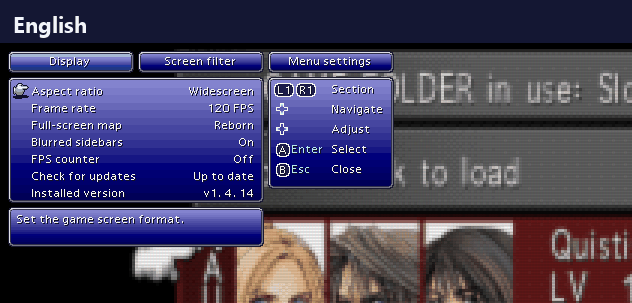
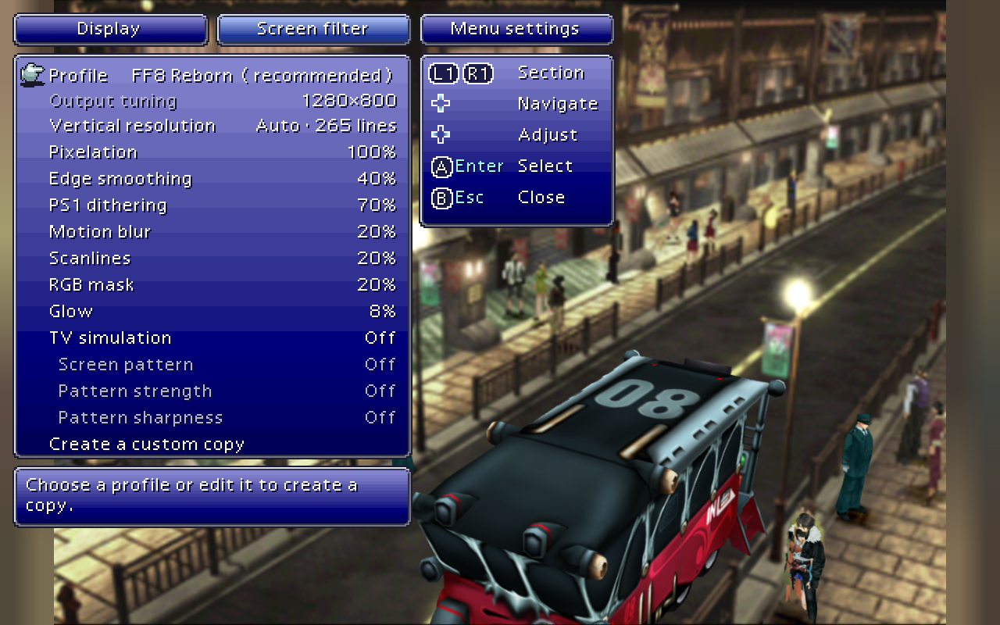

# FF8 Reborn

**[Descargar para Windows](https://github.com/Faga250885/FF8-Reborn/releases/latest/download/FF8-Reborn-Setup.exe)** · **[Descargar para Steam Deck](https://github.com/Faga250885/FF8-Reborn/releases/download/v1.4.0-deck.25/FF8-Reborn-Deck-Setup)** · [Read in English](README.md) · [Galería de capturas](docs/GALERIA.md)

> [!WARNING]
> **120 FPS y pantalla ancha son experimentales.** En ciertas escenas o efectos todavía pueden aparecer defectos visuales o bajar los FPS. En **Display** puedes elegir el encuadre original 4:3 y la cadencia original del juego.

> [!NOTE]
> **Steam Deck sigue en desarrollo.** Las pruebas de juego en una Deck física confirmaron **30 FPS estables** en batallas, ciudades y mapamundi al elegir la opción de 30 FPS. **El próximo objetivo son los 60 FPS.** El desarrollo continuará a medida que haya tiempo disponible. Todavía no hay fecha para ese modo.

FF8 Reborn es un mod visual gratuito para **FINAL FANTASY VIII Remastered** de Steam. Puedes elegir la cadencia original del juego o apuntar a 30 FPS en Steam Deck y a 30, 60, 90 o 120 FPS en Windows. También puedes ampliar la cámara de batallas y mapamundi y ajustar cómo se integran los personajes en los fondos prerenderizados. Los cambios se pueden probar mientras juegas.

**Compatibilidad con los seis idiomas del juego en Steam.** El menú de Reborn y sus avisos en pantalla siguen automáticamente el idioma del lanzador. [Inglés, español, francés, alemán, italiano y japonés](docs/GALERIA.md#menu-languages)

Si F8 no abre al jugar en japonés con una versión anterior, ejecuta el instalador actual para actualizar.

**En desarrollo.** Si encuentras un fallo, [abre un reporte en GitHub](https://github.com/Faga250885/FF8-Reborn/issues/new?template=bug.yml) o añade tus observaciones a una incidencia existente. Puedes escribir en español.

## El menú durante la partida

Abre el menú con **F8** o **Select + Start** y cambia los ajustes mientras juegas. La sección activa permanece resaltada y la manito recorre las opciones y las secciones superiores. Haz clic en cualquier imagen para abrirla a tamaño completo.

[Abrir las capturas individuales del juego a tamaño completo](docs/GALERIA.md#menu-languages)

**Display**

**Screen filter**

**Menu settings**

Estas vistas utilizan el renderizador actual del mod sobre una escena capturada del juego. También puedes ver el [instalador](#instalar-y-jugar), el [aviso y las pantallas de actualización](docs/GALERIA.md#settings-menu).

## Novedades

- **Bordes verticales al mover la cámara.** Windows 1.4.24 comprueba los bordes superior e inferior del mapamundi y de las batallas durante la interpolación. Si un cuadro intermedio abriría un hueco, el mod muestra el cuadro del juego durante ese intervalo.
- **Cortes de cámara en batalla.** Windows 1.4.23 conserva los cambios de plano de las entradas de batalla y mantiene la interpolación durante los giros continuos. También detecta huecos pequeños en el borde inferior del escenario en pantalla ancha.
- **Transiciones y cinemáticas en pantalla ancha.** La vista anterior conserva su encuadre hasta que empieza a dibujarse la batalla. Las cinemáticas mantienen el encuadre nativo del vídeo, los modelos y las máscaras.
- **Interfaz de batalla en pantalla ancha.** El cronómetro queda alineado con las barras de turno a la derecha. El contador de munición y la barra de tiempo de Disparo también van a la derecha. El menú de combos de Duelo va a la izquierda y su cronómetro a la derecha.
- **Menús de batalla en pantalla ancha.** Los nombres se leen durante el cambio de página en Magia Azul. Las pruebas en Windows cubrieron los 16 hechizos de Magia Azul y los 8 tipos de munición.
- **Límites y destellos de batalla.** Los giros de cámara conservan la cobertura del escenario si un cuadro intermedio dejaría un hueco. Los efectos de fragmentación que ocupan toda la pantalla llegan a ambos bordes panorámicos. Probamos el límite de cada uno de los once personajes jugables en Windows.
- **Correcciones en batallas panorámicas.** El cursor queda junto al comando en batallas con cronómetro. El nombre, los PV y la barra de carga del GF quedan alineados, y los destellos, las distorsiones y los fondos de invocación que cubren la pantalla se extienden a ambos bordes. [Incidencia #2](https://github.com/Faga250885/FF8-Reborn/issues/2)
- **FPS automáticos en Windows.** En **Pantalla → Velocidad de cuadros** puedes elegir Auto, Original, 30, 60, 90 y 120 FPS. El objetivo de 120 FPS es experimental tanto en Auto como en modo manual.
- **Zoom y giros de cámara en batalla.** Windows 1.4.22 interpola la geometría 3D con la profundidad de cámara para evitar el estiramiento por perspectiva en los cuadros generados. Se conservan las poses originales y la posición del HUD.
- **Soporte completo de idiomas.** Windows **v1.4.14** y Steam Deck **v1.4.0-deck.20** traducen las tres secciones del menú, los filtros, las confirmaciones y los avisos en pantalla. En Windows probamos F8 en los seis idiomas y comprobamos que el cambio entre panorámico y 4:3 se aplica en vivo en el mapamundi. [Ver la galería de idiomas](docs/GALERIA.md#menu-languages)
- **Menú clásico.** Las tres secciones están arriba y la activa permanece resaltada. Pulsa arriba desde la primera opción para llevar la manito a las secciones, elige con izquierda o derecha y abre con A o Intro. Al recorrer las opciones, L1 y R1 cambian de sección inmediatamente. La ayuda muestra iconos de la cruceta y los botones.
- **Resolución automática del filtro.** Cada perfil elige la resolución de su señal según la ventana del juego. Izquierda o derecha la ajustan de 5 en 5 líneas. Intro o A vuelve a Auto. Los nueve controles de porcentaje se ajustan de 10 en 10.
- **Difuminado lateral.** Se corrigió la línea oscura que aparecía entre el margen izquierdo y el escenario prerenderizado a 1280×800. El difuminado ahora se alinea con el borde que dibuja el juego.
- **Actualizaciones desde Windows y Steam Deck.** Al iniciar el juego, FF8 Reborn consulta una vez el canal de su plataforma. Cuando hay una versión nueva, aparece un aviso azul arriba a la izquierda y suena el canto breve de un Chocobo. Suena una vez por versión en cada sesión de juego. El aviso permanece diez segundos y se desvanece en dos. Abre el menú con **F8** o **Select + Start** para ver la versión instalada y la disponible. Elige **Download update** cuando quieras instalarla.
- **Filtros adaptados a tu resolución.** El mismo perfil ajusta el muestreo y la rejilla CRT para Steam Deck a 720p/800p, Full HD a 1080p, QHD a 1440p y 4K a 2160p. **Screen filter → Output tuning** muestra la resolución activa. Cada perfil tiene su propia intensidad de **Motion blur**, ajustable del 0 % al 100 % en pasos de 10.
- **Rendimiento en Steam Deck.** El modo de 30 FPS usa los cuadros nativos en ciudades y mapamundi e interpola las batallas. Las pruebas de juego en una Deck física confirmaron 30 FPS estables en esas escenas. La versión de Deck sigue siendo experimental y el objetivo de desarrollo es llegar a 60 FPS. Windows también incorpora parte de las optimizaciones de renderizado.
- **Batallas y transiciones en pantalla ancha.** Los destellos llegan a ambos bordes incluso cuando el juego los dibuja por partes. Lo comprobamos en Galbadia con «¡Ángelo al ataque!» de Rinoa. Las pantallas de experiencia, objetos y puntos de habilidad aprovechan el alto disponible y dejan espacio para las ayudas activas. La escena conserva su tamaño al entrar a Triple Triad. Al mover la cámara en batalla, la interpolación comprueba si se forman triángulos que unen combatientes distintos.

En 66 pares de cuadros de batalla grabados, la comprobación detectó triángulos estirados en 21 pares con la versión anterior y en cero tras el cambio. Se conservó el movimiento interpolado del 99,1 % de los vértices que ya lo tenían. Los paneles de experiencia y objetos se midieron en una batalla real a 2560 × 1440.

En pantalla ancha, las dos pantallas de título aprovechan la altura disponible. En el título negro, las llamas dibujadas para cada lateral se extienden hasta los bordes y se funden junto al emblema original. El fondo del título blanco ocupa todo el ancho y ambos logos conservan sus proporciones. La selección de ranura y la lista de partidas se ajustan como el menú del juego.

## Video del mod en acción

[Ver la demostración de FF8 Reborn en YouTube](https://www.youtube.com/watch?v=dBUX5gA7oKM).

## Funciones generales

[Ver las capturas, la medición de FPS y los ejemplos a tamaño completo](docs/GALERIA.md#features).

## Steam Deck (SteamOS, experimental)

| Cadencia | Ciudades y mapamundi | Batallas |
| --- | --- | --- |
| **Original** (predeterminada) | El juego dibuja a su ritmo habitual, normalmente unos 30 FPS. | El juego muestra el combate a su ritmo habitual, normalmente unos 15 FPS. |
| **30 FPS** | Usa los cuadros que dibuja el propio juego al mismo ritmo que en Original, también en pantalla ancha. | Interpola el movimiento entre poses compatibles de la animación original de 15 FPS para mostrar una imagen cada 33,3 ms. Los ataques y sus ventanas de entrada siguen el reloj del juego. |

Los menús y las cinemáticas conservan su cadencia original. En cambios de plano y cuadros de combate que no se puedan emparejar de forma fiable, puede mantenerse la imagen original. En una escena grabada con seis personajes, el mod evitó 414 de 447 copias de geometría en un cuadro y conservó la imagen completa.

En una batalla grabada de 42 segundos a 1280 × 800 en Windows, la versión 1.4.0-deck.4 envió 30,00 cuadros/s. Al subir a 53 ms el trabajo simulado por cada ciclo de combate, envió 29,51 cuadros/s y el percentil 99 del intervalo entre imágenes llegó a 52,39 ms.

### Instalar o actualizar en Steam Deck

Si tienes la versión **1.4.0-deck.1** o posterior, pulsa **View + Menu → Check for updates → Download update**. Cuando aparezca **Update ready**, cierra FFVIII y su lanzador y vuelve a abrir el juego. Si ya tenías seleccionado **Original**, se conserva. Para instalar por primera vez, sigue estos pasos.

1. Instala **FINAL FANTASY VIII Remastered** en Steam. Cierra el juego y su lanzador.
2. Cambia al modo Escritorio y descarga [FF8-Reborn-Deck-Setup](https://github.com/Faga250885/FF8-Reborn/releases/download/v1.4.0-deck.25/FF8-Reborn-Deck-Setup).
3. En Dolphin, haz clic derecho sobre el archivo. En **Propiedades → Permisos**, marca **Es ejecutable** y pulsa **Aceptar**.
4. Abre el archivo con doble clic y pulsa **Install**. Cuando termine, vuelve al modo Juego y abre FFVIII desde Steam. Pulsa **Vista + Menú** a la vez para abrir los ajustes del mod.

El instalador reconoce las bibliotecas de Steam, incluidas las de la microSD. Si te pide localizar una biblioteca, elige la carpeta que contiene `steamapps`. Para quitar el mod, cierra el juego, abre de nuevo el instalador y elige **Uninstall**. La interfaz usa Python 3.8 o superior y Zenity. También está disponible el [instalador de línea de comandos](https://github.com/Faga250885/FF8-Reborn/releases/download/v1.4.0-deck.25/FF8-Reborn-Deck.pyz).

Si acabamos de publicar una versión y ves **Up to date**, compara **Display → Installed version** con la versión de Steam Deck que aparece arriba. GitHub puede tardar unos minutos en mostrarla al juego. Pulsa **Check for updates** de nuevo. Si la fila cambia a **Download update**, pulsa **A** otra vez para descargarla. También puedes cerrar FFVIII y usar **Update or repair** en el instalador de modo Escritorio para actualizar conservando tus ajustes.

Para usar solo los filtros, abre el panel del mod con **Vista + Menú**. Selecciona **Original** en **Frame rate**, **Original (4:3)** en **Aspect ratio** y **Original** en **Full-screen map**. Después elige el filtro gráfico que prefieras.

## GOG para Windows

El instalador reconoce la edición GOG. Si encuentra ambas tiendas, permite elegir la copia. El motor de GOG 1.0.3 difiere del de Steam y su instalación del mod está pendiente de adaptación y pruebas.

## Requisitos para Windows

FF8 Reborn aún no tiene una GPU mínima medida para 60 o 120 FPS. A 120 FPS, la CPU y la GPU disponen de unos 8,3 ms por cuadro. Influyen la resolución y la complejidad de la escena. En una prueba de diez segundos en el mapamundi a 2560 × 1440, un Ryzen 5 7600X con una RTX 5070 promedió 118,2 FPS mostrados en pantalla. [Medición de FPS](docs/GALERIA.md#frame-rate)

La versión 1.4.21 de Windows reduce las copias de los búferes de imagen y lee juntas las dos muestras que validan cada escena. En una prueba con una RTX 5070, la mediana para dibujar cuatro cuadros intermedios de la misma batalla bajó de **10,34 a 9,35 ms a 1080p** y de **9,71 a 8,77 ms a 4K**. Son tiempos de renderizado de una escena grabada. Las comparaciones de escenarios prerenderizados, mapamundi y batalla a 1080p, 1440p y 4K dieron los mismos resultados de color, profundidad y máscaras.

- Un PC con Windows y la cuenta de Steam propietaria de [FINAL FANTASY VIII Remastered (app 1026680)](https://store.steampowered.com/app/1026680/FINAL_FANTASY_VIII__REMASTERED/).
- La edición compatible de Steam para Windows con `FFVIII_EFIGS.dll`. El instalador comprueba el motor y la DLL de audio original. La edición de PC de 2013 y la de PlayStation usan otros motores.
- Inicia el juego desde Steam. Al arrancar, el mod comprueba la aplicación, la licencia y la cuenta propietaria. Una copia prestada o de fin de semana gratuito no activa el mod. La descarga contiene únicamente el mod.
- Para ver 120 FPS, usa una pantalla de al menos 120 Hz y selecciona esa frecuencia en Windows. Los cuadros que llegan a pantalla dependen de la escena, la GPU y el monitor.

## Instalar y jugar

1. Instala el juego en Steam y cierra tanto FFVIII como su lanzador.
2. Descarga y ejecuta **[FF8-Reborn-Setup.exe](https://github.com/Faga250885/FF8-Reborn/releases/latest/download/FF8-Reborn-Setup.exe)**. Este instalador contiene el mod completo. Puedes usarlo sin un gestor de mods ni Lossless Scaling.
3. Revisa **Game folder**. Si hace falta, usa **Browse** y elige la carpeta que abre Steam desde **Administrar → Ver archivos locales**.
4. Pulsa **Install**. El instalador conserva una copia de la DLL de audio original.
5. Abre el juego desde Steam. Pulsa **F8** o **Select + Start** para abrir el menú del mod.

[Ver el menú actual, los avisos y las pantallas de actualización](docs/GALERIA.md#settings-menu).

**Auto** es el ajuste predeterminado en una instalación nueva de Windows. Apunta a **30 FPS** por debajo de 60 Hz, **60 FPS** a partir de 60 Hz, **90 FPS** a partir de 90 Hz y **120 FPS** a partir de 120 Hz. Si Windows informa 59, 89 o 119 Hz, se toma la frecuencia nominal correspondiente. Por ejemplo, en un monitor de 75 Hz verás **Auto · 60 FPS** y en uno de 144 Hz, **Auto · 120 FPS**. Cuando Windows no informa la frecuencia, Auto usa 60 FPS. Auto sigue el monitor donde está abierto el juego. Se conserva la selección manual que ya tengas guardada y puedes elegir 120 FPS manualmente desde el menú.

Windows 1.4.1 aprovecha una mejora de Steam Deck que evita repetir ajustes de OpenGL al dibujar el juego. En nueve grabaciones de ciudades, mapamundi y batallas, los 324 cuadros comparados coincidieron en color, profundidad y esténcil. En una batalla a 1080p con una GeForce RTX 5070, el tiempo mediano para volver a dibujar un cuadro con un búfer de vértices bajó de 2,95 a 2,73 ms. La prueba de batalla a 60 FPS mantuvo su objetivo. A 120 FPS, las batallas usan la ruta de renderizado anterior porque dio un ritmo más estable en pruebas repetidas.

## Opciones

| Opción del menú | Para qué sirve |
| --- | --- |
| Frame rate | Elige **Auto**, **Original**, **30**, **60**, **90** o **120 (experimental)** en Windows, y **Original** o **30** en Deck. El mod dibuja cuadros intermedios para los movimientos compatibles. Se mantienen los tiempos de animación y de entrada en combate. Algunos cuadros pueden mostrarse a su cadencia original. |
| FPS counter | Muestra los FPS arriba a la izquierda con tipografía pixelada. Elige **Off** (predeterminado), **Small**, **Medium** o **Large**. Cuenta los cuadros que presenta el juego, incluidos los intermedios, y actualiza la cifra aproximadamente dos veces por segundo. |
| Aspect ratio | **Widescreen (experimental)** amplía la cámara de batallas y mapamundi. **Original (4:3)** recupera el encuadre original. |
| Blurred sidebars | Disponible en todos los escenarios prerenderizados en pantalla ancha. Rellena los márgenes con colores de la escena, incluidos los personajes cerca de los bordes. Deling se muestra como ejemplo. |
| Full-screen map | Alterna entre el mapa **Original** y el atlas ilustrado **Reborn**. El mapa completo queda centrado y conserva sus proporciones. |
| Screen filter | Permite elegir un perfil y ajustar resolución, pixelado, líneas de barrido, máscara RGB, resplandor, tramado PS1, suavizado de bordes y desenfoque de movimiento. Los controles disponibles dependen del tipo de filtro. |

## Filtros gráficos

Abre el menú con **F8** o **Select + Start** y mira **Screen filter → Output tuning**. FF8 Reborn lee las dimensiones en píxeles de la ventana del juego y adapta el filtro elegido mientras juegas. Al redimensionar la ventana o conectar la Steam Deck a un monitor, el ajuste se actualiza si cambia la resolución de salida del juego. Tu perfil y los valores guardados en Custom se conservan al cambiar de pantalla.

| Ejemplo de resolución del juego | Ajuste interno |
| --- | --- |
| 1280 × 720 o 1280 × 800 (Steam Deck) | 720p / 800p |
| 1920 × 1080 (Full HD) | 1080p |
| 2560 × 1440 (QHD) | 1440p (2K) |
| 3840 × 2160 (4K UHD) | 2160p (4K) |

Ver Output tuning en el panel a 1280 × 800

La línea muestra el tamaño real de la ventana del juego. El juego elige el ajuste interno según la altura, también en pantallas ultrapanorámicas. Pasa al siguiente nivel a partir de 940, 1260 y 1800 píxeles de alto. Por ejemplo, una ventana de 1920 × 1080 sobre un monitor 4K usa el ajuste de 1080p. **Vertical resolution** controla las líneas de la señal simulada y sigue siendo ajustable en cada nivel.

En 720p, 800p y 1080p, el filtro CRT estándar reduce el contraste de la máscara RGB y los filtros de televisor mantienen los fósforos lo bastante anchos como para distinguirlos. En 1440p se conserva el aspecto de referencia. En 4K, el patrón RGB crece con la imagen y el filtro toma muestras de una zona más amplia de cada píxel simulado.

Elige **Screen filter → Profile → Off** para apagar todos los efectos del filtro, incluido el desenfoque de movimiento y la simulación de televisor. Cada perfil elige su propio método de dibujo. Los controles inactivos se atenúan y el cursor los salta.

Activa **TV simulation** para ajustar los tres controles que tiene debajo. **Screen pattern** elige el patrón de fósforos de color del tubo, **Pattern strength** regula cuánto se ve y **Pattern sharpness** ajusta lo suave o definido que se ve ese patrón. La simulación viene encendida en los perfiles Sony Trinitron y los dos RCA. En los demás perfiles de fábrica, incluido **HD Blend**, viene apagada. Elige **Create a custom copy** o **Save my changes** para guardar tu combinación.

**Vertical resolution** empieza en **Auto**. La tabla muestra la altura de la señal que simula cada perfil. PS1 Digital y los perfiles de televisor y monitor clásicos toman como referencia el modo de 240 líneas sin entrelazado de PlayStation. PS1 Sharp y HD Blend muestran más detalle conforme aumenta la altura disponible. [Manual de hardware de Sony PlayStation, capítulo 3](https://psx.arthus.net/sdk/Psy-Q/DOCS/Devrefs/Hardware.pdf).

| Filtro | 720p | 800p (Deck) | 1080p | 1440p | 2160p |
| --- | ---: | ---: | ---: | ---: | ---: |
| PS1 Digital, PS1 · RGB Monitor, PS1 · CRT TV, Sony Trinitron, RCA Precision In-Line, RCA CT-100 | 240 | 240 | 240 | 240 | 240 |
| Soft CRT, PS1 Backgrounds, FF8 Reborn (recommended) | 240 | 265 | 320 | 320 | 320 |
| PS1 Sharp | 240 | 265 | 360 | 480 | 480 |
| HD Blend | 320 | 320 | 360 | 480 | 720 |

Con **Vertical resolution** seleccionado, pulsa izquierda o derecha para probar un valor manual de 120 a 720 líneas en pasos de 5. Pulsa Intro o A sobre la misma fila para volver a Auto. Elige **Create a custom copy** o **Save my changes** para guardar el ajuste. Los perfiles personalizados que ya tenías guardados conservan su resolución manual al cambiar de pantalla o redimensionar la ventana.

Tres perfiles de televisor simulan cómo el haz ilumina los fósforos del tubo. **Sony Trinitron KV-27FS100** usa franjas RGB continuas, **RCA Precision In-Line** usa ranuras escalonadas y **RCA CT-100** usa puntos agrupados en triángulos. En el panel puedes graduar **RGB mask** para distinguir más o menos el fósforo y **Scanlines** para ajustar la separación visible entre líneas. [Comparar los tres a resolución completa](docs/GALERIA.md#televisores).

[Abrir las capturas originales de todos los filtros a 2560 × 1440](docs/GALERIA.md#filters).

**FF8 Reborn (recommended)** combina líneas de barrido y tramado suaves con hasta 320 líneas simuladas. **HD Blend** conserva una apariencia de mayor resolución. Compara colores cercanos a dos distancias, suaviza los cambios bruscos de color y limita la variación de brillo en los detalles finos. Puedes graduarlo con **Edge smoothing**. [Comparar todos los perfiles frente al Hotel Galbadia](docs/GALERIA.md#hd-blend).

También puedes elegir **PS1 Digital**, **Soft CRT**, **PS1 · RGB Monitor**, **PS1 Backgrounds**, **PS1 · CRT TV**, **PS1 Sharp** u **Off**.

### Desenfoque de movimiento por filtro

En **Screen filter → Motion blur**, usa izquierda o derecha para ajustar la intensidad en vivo de **Off** a **100 %** en pasos de 10. El efecto sigue a los personajes y los giros de cámara en ciudades, mapamundi y batallas. Estos valores dan a cada filtro su aspecto inicial.

| Desenfoque de fábrica | Filtros |
| --- | --- |
| Apagado | Off, PS1 Digital |
| 10 % | PS1 · RGB Monitor, PS1 Sharp, HD Blend, Sony Trinitron KV-27FS100 |
| 20 % | PS1 Backgrounds, FF8 Reborn (recommended), RCA Precision In-Line |
| 30 % | Soft CRT, PS1 · CRT TV |
| 40 % | RCA CT-100 |

## Menú y atajos

Abre el menú con **F8** o **Select + Start**. **Display** reúne las opciones de pantalla del juego, **Screen filter** los perfiles de imagen y **Menu settings** el tamaño del menú del mod. Ajusta **Menu size** del 70 % al 150 % en pasos de 10. Pulsa Intro o A sobre esa fila para volver al 100 %. El tamaño cambia en vivo y se guarda por separado de los perfiles de filtro.

Dentro del juego, la manito de 16 × 16 píxeles de FFVI señala la opción activa. El instalador usa el puntero del escritorio y resalta el botón que tiene el foco. El aviso de actualización reproduce una sola llamada de Chocobo de FFVII que dura 0,72 segundos. [Hoja de sprites de FFVI](https://www.spriters-resource.com/snes/ff6/asset/54693/) · [Grabación del Chocobo de FFVII](https://ffc.rpgclassics.com/low/species/chocobo.shtml).

| Acción | Teclado | Mando XInput / Steam Input |
| --- | --- | --- |
| Abrir el menú | F8 (fijo) | Mantén Select y pulsa Start (Vista + Menú en Xbox y Steam Deck) |
| Filtro de fábrica anterior / siguiente durante la partida | — | Mantén Select y pulsa LB / RB (L1 / R1) |
| Ir a las secciones superiores y señalar la siguiente / anterior | Tab / Mayús + Tab | Cruceta arriba desde la primera fila, luego izquierda / derecha |
| Cambiar de sección directamente al recorrer las opciones | — | LB / RB (L1 / R1) |
| Abrir la sección resaltada / regresar a la fila anterior | Intro / Esc | A / B |
| Recorrer las opciones | Arriba / Abajo | Cruceta o palanca izquierda arriba / abajo |
| Cambiar un valor o perfil | Izquierda / Derecha | Cruceta o palanca izquierda a los lados |
| Ejecutar la acción seleccionada | Intro | A |
| Cerrar el panel o revisar los cambios pendientes del filtro | Esc | B |

**Select es el modificador de los atajos predeterminados.** Mantenlo pulsado mientras das toques a L1 o R1 para comparar perfiles. Cada toque cambia un filtro y muestra brevemente su nombre arriba a la izquierda. Si sigues manteniendo Select y pulsas Start, se abre el menú. Una pulsación de Select por sí solo conserva su función en el juego al soltarlo.

En **Menu settings**, elige **Open menu**, **Previous filter** o **Next filter** y pulsa A o Intro. Suelta el botón con el que iniciaste la grabación y mantén uno o dos botones del mando durante un segundo. Un toque breve a B o la tecla Esc cancela la grabación. Pulsa izquierda sobre una de esas filas para recuperar su combinación predeterminada. Cada acción se configura por separado. En el teclado, F8 siempre abre el menú.

Los porcentajes del filtro se ajustan de 10 en 10 con el teclado o el mando. Un valor guardado como 32 % se conserva hasta que lo toques. Derecha lo lleva a 40 % e izquierda a 30 %.

Las opciones de pantalla y el tamaño del menú se guardan al cambiarlos. Al editar un filtro, el perfil aparece como **Custom (preview)**. Si cierras el menú con cambios pendientes, puedes guardarlos en **Custom**, descartarlos o seguir editando. Elegir otro perfil con izquierda o derecha descarta la vista previa. El juego recuerda el último perfil seleccionado.

Para conservar los cambios, elige **Create a custom copy**, **Save to my custom profile** o **Save my changes**, según tengas ya una copia personal. **Restore filter defaults** te permite probar los valores de fábrica del filtro base antes de decidir si quieres guardarlos.

[Ver el menú y los controles de filtro a resolución de Steam Deck](docs/GALERIA.md#settings-menu).

## Actualizar, desinstalar y resolver problemas

- **Actualizar desde el juego.** Elige **Download update** en **Display**. La barra muestra la descarga, la verificación y el guardado. Cuando aparezca **Update ready**, **Later** te permite seguir jugando. Una vez guardada la partida, elige **Close game now** y abre FFVIII otra vez desde Steam para aplicar la actualización. Si elegiste Later, puedes volver a **Update ready** cuando quieras.
- **Primera actualización desde una versión anterior.** Instala una vez la versión 1.4.0 de Windows o la 1.4.0-deck.1 de Steam Deck (o posterior) para añadir la opción al menú. Las siguientes actualizaciones usan automáticamente el canal estable de Windows o el experimental de Steam Deck. En Deck funciona desde el modo Juego. La consulta necesita internet y la descarga necesita permiso de escritura en la carpeta del juego. El instalador también sirve para reparaciones.
- **Desinstalar.** Cierra FFVIII y el lanzador, selecciona la carpeta del juego en el instalador y pulsa **Uninstall**. Se verifica y restaura la DLL original. La instalación no modifica las partidas.
- **F8 no responde.** Dale el foco a la ventana del juego y ábrelo desde la cuenta de Steam propietaria. En el mando, mantén Select y pulsa Start o usa tu atajo guardado. Si tu mando no ofrece XInput, usa una distribución de mando en Steam Input.
- **DLL inesperada o motor incompatible.** Comprueba la edición y la carpeta. Si otro mod utiliza `libvgmstream.dll`, retíralo con sus propias instrucciones antes de instalar FF8 Reborn.
- **Informar de un fallo visual.** Indica lugar, tipo de escena, FPS elegidos, formato de pantalla y filtro. Añade una captura si es un defecto fijo o un vídeo corto si ocurre en movimiento. [Abrir una incidencia](https://github.com/Faga250885/FF8-Reborn/issues).

## Proyecto

Creado por **Faga12**. FF8 Reborn es un proyecto de aficionados independiente. FINAL FANTASY VIII Remastered pertenece a sus respectivos titulares. [Código del renderizador](src/) · [Código del instalador](installer/) · [Compilación y verificación de la descarga](docs/BUILD.md) · [Versiones y sumas SHA-256](https://github.com/Faga250885/FF8-Reborn/releases).

La tipografía del menú utiliza **Reactor7**, de Caveras, bajo [CC BY-NC-SA 3.0](installer/Reactor7-LICENSE.txt).
