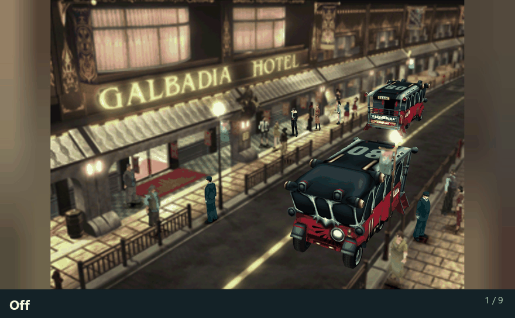

# FF8 Reborn

**[Descargar para Windows](https://github.com/Faga250885/FF8-Reborn/releases/latest/download/FF8-Reborn-Setup.exe)** · **[Descargar para Steam Deck](https://github.com/Faga250885/FF8-Reborn/releases/latest/download/FF8-Reborn-Deck-Setup)** · [Read in English](README.md) · [Galería de capturas](docs/GALERIA.md)

> [!WARNING]
> **La versión para Steam Deck es experimental y sigue en desarrollo. Por ahora solo funcionan correctamente los filtros gráficos.** Tanto la pantalla ancha como los modos de 60 y 120 FPS ralentizan el juego en Deck. Al activar ambos, la ralentización es mayor.

FF8 Reborn es un mod visual gratuito para **FINAL FANTASY VIII Remastered** de Steam. Permite elegir los FPS originales o apuntar a 60 o 120 FPS, ampliar la cámara de batallas y mapamundi y ajustar cómo se integran los personajes en los fondos prerenderizados. Los cambios se pueden probar mientras juegas. El menú y el instalador están en inglés.

**En desarrollo.** Si encuentras un fallo, [abre un reporte en GitHub](https://github.com/Faga250885/FF8-Reborn/issues/new?template=bug.yml) o añade tus observaciones a una incidencia existente. Puedes escribir en español.

## Funciones generales

[Ver las capturas, la medición de FPS y los ejemplos a tamaño completo](docs/GALERIA.md#features).

## Steam Deck (SteamOS, experimental)

1. Instala **FINAL FANTASY VIII Remastered** en Steam. Cierra el juego y su lanzador.
2. Cambia al modo Escritorio y descarga [FF8-Reborn-Deck-Setup](https://github.com/Faga250885/FF8-Reborn/releases/latest/download/FF8-Reborn-Deck-Setup).
3. En Dolphin, haz clic derecho sobre el archivo. En **Propiedades → Permisos**, marca **Es ejecutable** y pulsa **Aceptar**.
4. Abre el archivo con doble clic y pulsa **Install**. Cuando termine, vuelve al modo Juego y abre FFVIII desde Steam. Pulsa **Vista + Menú** a la vez para abrir los ajustes del mod.

El instalador reconoce las bibliotecas de Steam, incluidas las de la microSD. Si te pide localizar una biblioteca, elige la carpeta que contiene `steamapps`. Para quitar el mod, cierra el juego, abre de nuevo el instalador y elige **Uninstall**. La interfaz usa Python 3.8 o superior y Zenity. También está disponible el [instalador de línea de comandos](https://github.com/Faga250885/FF8-Reborn/releases/latest/download/FF8-Reborn-Deck.pyz).

Para usar solo los filtros, abre el panel del mod con **Vista + Menú**. Selecciona **Original** en **Frame rate**, **Original (4:3)** en **Aspect ratio** y **Original** en **Full-screen map**. Después elige el filtro gráfico que prefieras.

## GOG para Windows

El instalador reconoce la edición GOG. Si encuentra ambas tiendas, permite elegir la copia. El motor de GOG 1.0.3 difiere del de Steam y su instalación del mod está pendiente de adaptación y pruebas.

## Requisitos para Windows

- Un PC con Windows y la cuenta de Steam propietaria de [FINAL FANTASY VIII Remastered (app 1026680)](https://store.steampowered.com/app/1026680/FINAL_FANTASY_VIII__REMASTERED/).
- La edición compatible de Steam para Windows con `FFVIII_EFIGS.dll`. El instalador comprueba el motor y la DLL de audio original. La edición de PC de 2013 y la de PlayStation usan otros motores.
- Inicia el juego desde Steam. Al arrancar, el mod comprueba la aplicación, la licencia y la cuenta propietaria. Una copia prestada o de fin de semana gratuito no activa el mod. La descarga contiene únicamente el mod.
- Para ver 120 FPS, usa una pantalla de al menos 120 Hz y selecciona esa frecuencia en Windows. Los cuadros que llegan a pantalla dependen de la escena, la GPU y el monitor.

## Instalar y jugar

1. Instala el juego en Steam y cierra tanto FFVIII como su lanzador.
2. Descarga y ejecuta **[FF8-Reborn-Setup.exe](https://github.com/Faga250885/FF8-Reborn/releases/latest/download/FF8-Reborn-Setup.exe)**. Este instalador contiene el mod completo. Puedes usarlo sin un gestor de mods ni Lossless Scaling.
3. Revisa **Game folder**. Si hace falta, usa **Browse** y elige la carpeta que abre Steam desde **Administrar → Ver archivos locales**.
4. Pulsa **Install**. El instalador conserva una copia de la DLL de audio original.
5. Abre el juego desde Steam. Pulsa **F8** o **Select + Start** para abrir el menú del mod.

Con una instalación nueva, el mod apunta a **60 FPS** si el monitor del juego está configurado a 60 Hz o menos, y a **120 FPS** si Windows informa más de 60 Hz. Si Windows no informa la frecuencia, usa 60 FPS. Puedes elegir otra cadencia en el menú.

## Opciones

| Opción del menú | Para qué sirve |
| --- | --- |
| Frame rate | Elige **Original**, **60** o **120**. El mod dibuja cuadros intermedios para los movimientos compatibles. Se mantienen los tiempos de animación y de entrada en combate. Algunos cuadros pueden mostrarse a su cadencia original. |
| Aspect ratio | **Widescreen** amplía la cámara de batallas y mapamundi. **Original (4:3)** recupera el encuadre original. |
| Blurred sidebars | Disponible en todos los escenarios prerenderizados en pantalla ancha. Rellena los márgenes con colores de la escena, incluidos los personajes cerca de los bordes. Deling se muestra como ejemplo. |
| Full-screen map | Alterna entre el mapa **Original** y el atlas ilustrado **Reborn**. El mapa completo queda centrado y conserva sus proporciones. |
| Screen filter | Permite elegir un perfil y ajustar resolución, pixelado, líneas de barrido, máscara RGB, resplandor, tramado PS1 y suavizado de bordes. Los controles disponibles dependen del tipo de filtro. |

## Filtros gráficos

[Abrir las capturas originales de todos los filtros a 2560 × 1440](docs/GALERIA.md#filters).

**FF8 Reborn (recommended)** combina 320 líneas con líneas de barrido y tramado suaves. **HD Blend** conserva una apariencia de mayor resolución. Compara colores cercanos a dos distancias, suaviza los cambios bruscos de color y limita la variación de brillo en los detalles finos. Puedes graduarlo con **Edge smoothing**. [Comparar todos los perfiles frente al Hotel Galbadia](docs/GALERIA.md#hd-blend).

También puedes elegir **PS1 Digital**, **Soft CRT**, **PS1 · RGB Monitor**, **PS1 Backgrounds**, **PS1 · CRT TV**, **PS1 Sharp** u **Off**.

## Menú y atajos

| Acción | Teclado | Mando XInput / Steam Input |
| --- | --- | --- |
| Abrir o cerrar el panel | F8 | Select + Start (Vista + Menú en Xbox) |
| Recorrer las opciones | Arriba / Abajo | Cruceta o palanca izquierda arriba / abajo |
| Cambiar un valor o perfil | Izquierda / Derecha | Cruceta o palanca izquierda a los lados |
| Ajustar un número en pasos mayores | Mayús + Izquierda / Derecha | Mantener el botón superior derecho (RB) al ajustar |
| Ejecutar la acción seleccionada | Intro | A |
| Descartar la edición del filtro y cerrar | Esc | B |

Las opciones de pantalla se guardan al cambiarlas. Los filtros tienen sus propios perfiles. Para crear el tuyo, elige un perfil, modifícalo y pulsa **Create a custom copy**. Si ya tienes una copia, **Save to my custom profile** sustituye ese único perfil personal. Al editarlo, usa **Save my changes**. **Restore filter defaults** aparece cuando los valores difieren de los originales del filtro base. El juego recuerda el último perfil elegido.

[Ver el panel dentro del juego](docs/GALERIA.md#frame-rate).

## Actualizar, desinstalar y resolver problemas

- **Actualizar.** Cierra el juego y su lanzador y abre el último instalador. Pulsa **Install** para actualizar. Se conservan tus preferencias.
- **Desinstalar.** Cierra FFVIII y el lanzador, selecciona la carpeta del juego en el instalador y pulsa **Uninstall**. Se verifica y restaura la DLL original. La instalación no modifica las partidas.
- **F8 no responde.** Dale el foco a la ventana del juego y ábrelo desde la cuenta de Steam propietaria. En el mando pulsa ambos botones a la vez. Si tu mando no ofrece XInput, usa una distribución de mando en Steam Input.
- **DLL inesperada o motor incompatible.** Comprueba la edición y la carpeta. Si otro mod utiliza `libvgmstream.dll`, retíralo con sus propias instrucciones antes de instalar FF8 Reborn.
- **Informar de un fallo visual.** Indica lugar, tipo de escena, FPS elegidos, formato de pantalla y filtro. Añade una captura si es un defecto fijo o un vídeo corto si ocurre en movimiento. [Abrir una incidencia](https://github.com/Faga250885/FF8-Reborn/issues).

## Proyecto

Creado por **Faga12**. FF8 Reborn es un proyecto de aficionados independiente. FINAL FANTASY VIII Remastered pertenece a sus respectivos titulares. [Código del renderizador](src/) · [Código del instalador](installer/) · [Compilación y verificación de la descarga](docs/BUILD.md) · [Versiones y sumas SHA-256](https://github.com/Faga250885/FF8-Reborn/releases).
