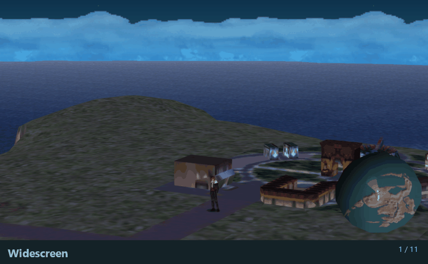
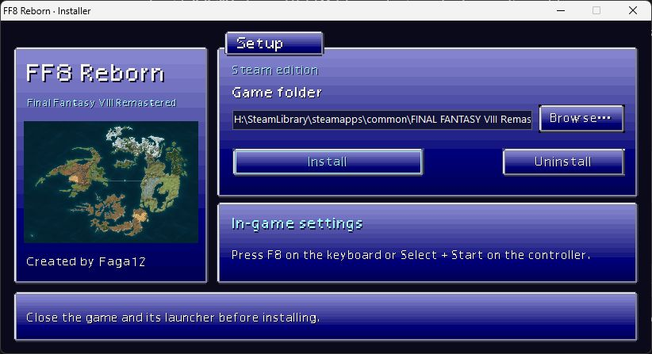
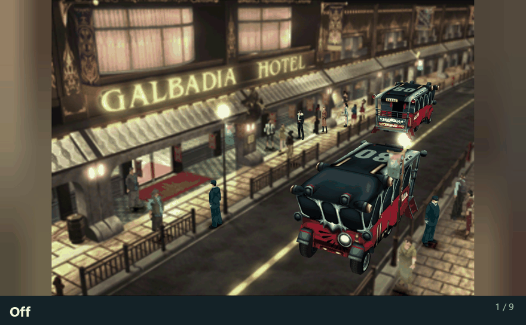

# FF8 Reborn

**[Download for Windows](https://github.com/Faga250885/FF8-Reborn/releases/latest/download/FF8-Reborn-Setup.exe)** · **[Download for Steam Deck](https://github.com/Faga250885/FF8-Reborn/releases/download/v1.4.0-deck.5/FF8-Reborn-Deck-Setup)** · [Leer en español](README.es.md) · [Screenshot gallery](docs/GALLERY.md)

> [!WARNING]
> **Steam Deck is experimental.** A player confirmed stable 30 FPS on their Deck with version 1.4.0-deck.4. Version 1.4.0-deck.5 adds three optional motion effects, all off by default. These effects were tested on Windows with the Deck renderer. Their performance on a physical Deck still needs confirmation.

FF8 Reborn is a free visual mod for **FINAL FANTASY VIII Remastered** on Steam. Choose the original frame rate or target 30 FPS on Steam Deck and 60 or 120 FPS on Windows. Widen the view in battle and on the world map, and tune the way character models blend into prerendered backgrounds. Change the settings while playing.

**In active development.** If you find a bug, [report it on GitHub](https://github.com/Faga250885/FF8-Reborn/issues/new?template=bug.yml) or add a comment to an existing issue. Reports in English or Spanish are welcome.

## Gameplay video

[Watch the FF8 Reborn demo on YouTube](https://www.youtube.com/watch?v=dBUX5gA7oKM).

## Gameplay features

[See the full-size screenshots and frame-rate measurement](docs/GALLERY.md#features).

## Steam Deck (SteamOS, experimental)

| Frame rate | Towns and world map | Battles |
| --- | --- | --- |
| **Original** (default) | The game draws at its native pace, usually around 30 FPS. | The game draws combat at its native pace, usually around 15 FPS. |
| **30 FPS** | Uses the game's own frames at the same pace as Original, including the widescreen view. | Interpolates motion between compatible 15 FPS battle poses, targeting a new image every 33.3 ms. Combat inputs and animation timing follow the game clock. |

Menus and movies keep their native timing. Scene changes and battle frames that cannot be matched safely can hold the original image. In a recorded field with six characters, the mod skipped 414 of 447 geometry copies in one frame and preserved the complete image.

In a 42-second battle replay at 1280 × 800 on Windows, version 1.4.0-deck.4 submitted 30.00 frames/s. With simulated game work raised to 53 ms per battle update, it submitted 29.51 frames/s and the 99th-percentile interval reached 52.39 ms.

### Motion effects on Steam Deck

Press **View + Menu** together and find **Motion effects**. Each slider starts at **Off** and saves independently of your screen filter. Adjust with Left/Right in steps of 5 percentage points, or hold **RB** on the controller or **Shift** on the keyboard for steps of 20.

| Setting | Where the effect appears |
| --- | --- |
| **Battle character blur** | Softens moving fighters and enemies during **30 FPS** battles, using the motion between matched poses. |
| **Field background blur** | Softens supported prerendered scenery while the field camera scrolls. Characters drawn over the scenery keep their own rendering. |
| **CRT persistence** | Adds a short glow along moving edges in fields, on the world map and in battle. It works with any screen-filter preset, including **Off**. |

For a subtle CRT glow, start with **CRT persistence at 25%** and leave the other two effects off. At 1280 × 800 in a recorded battle, the Deck renderer on Windows submitted 30.00 frames/s with all three effects off, 29.99 with only persistence at 25%, and 28.92 with all three sliders at 100%. The recommended screen filter was enabled in all three runs.

### Install or update on Steam Deck

If you have version **1.4.0-deck.1** or later, press **View + Menu → Check for updates → Download update**. When **Update ready** appears, close FFVIII and its launcher, then reopen the game. An existing **Original** selection is preserved. For a first install, follow the steps below.

1. Install **FINAL FANTASY VIII Remastered** from Steam. Close the game and its launcher.
2. Switch to Desktop Mode and download [FF8-Reborn-Deck-Setup](https://github.com/Faga250885/FF8-Reborn/releases/download/v1.4.0-deck.5/FF8-Reborn-Deck-Setup).
3. In Dolphin, right-click the downloaded file. Under **Properties → Permissions**, check **Is executable** and click **OK**.
4. Double-click the file and choose **Install**. When it finishes, return to Gaming Mode and launch FFVIII from Steam. Press **View + Menu** together to open the mod settings.

The installer finds registered Steam libraries, including microSD cards. If it asks you to locate a library, choose the folder containing `steamapps`. To remove the mod, close the game, reopen the installer and select **Uninstall**. The graphical installer uses Python 3.8+ and Zenity. A [command-line installer](https://github.com/Faga250885/FF8-Reborn/releases/download/v1.4.0-deck.5/FF8-Reborn-Deck.pyz) is also available.

To use just the filters, open the in-game panel with **View + Menu**. Set **Frame rate** to **Original**, **Aspect ratio** to **Original (4:3)** and **Full-screen map** to **Original**, then choose your screen filter.

## GOG for Windows

Setup recognizes the GOG edition. When both stores are detected, you can select the installation. The GOG 1.0.3 engine differs from Steam’s and still needs a renderer port and gameplay validation.

## Windows requirements

FF8 Reborn has no measured minimum GPU for 60 or 120 FPS. The 120 FPS target gives the CPU and GPU about 8.3 ms per output frame. Resolution and scene complexity matter. A 10-second world-map run on a Ryzen 5 7600X and RTX 5070 at 2560 × 1440 averaged 118.2 displayed FPS. [Frame-rate measurement](docs/GALLERY.md#frame-rate)

- A Windows PC and the Steam account that owns [FINAL FANTASY VIII Remastered (app 1026680)](https://store.steampowered.com/app/1026680/FINAL_FANTASY_VIII__REMASTERED/).
- The supported Windows Steam build with `FFVIII_EFIGS.dll`. The installer checks the engine and original audio DLL before making changes. The 2013 PC release and the original PlayStation game use different engines.
- Launch through Steam. At startup, the mod checks the active Steam app, license and account ownership. A borrowed copy or free-weekend session does not activate the mod. The download contains the mod only.
- For 120 FPS output, use a display capable of at least 120 Hz and select its high refresh rate in Windows. Actual frame delivery depends on the scene, GPU and display.

## Install and play

1. Install the game in Steam. Close the game and the FFVIII launcher.
2. Download **[FF8-Reborn-Setup.exe](https://github.com/Faga250885/FF8-Reborn/releases/latest/download/FF8-Reborn-Setup.exe)** from Releases and run it. This single installer contains the mod. You do not need a mod manager or Lossless Scaling.
3. Check **Game folder**. If needed, choose **Browse** and select the folder Steam opens under **Manage → Browse local files**.
4. Click **Install**. The installer keeps a backup of the original audio DLL.
5. Launch the game from Steam. Press **F8** or **Select + Start** to open FF8 Reborn.

On a fresh Windows install, the game targets **60 FPS** when its monitor runs at 60 Hz or below and **120 FPS** when Windows reports more than 60 Hz. If the refresh rate is unavailable it defaults to 60 FPS. Choose another target in the live menu at any time.

## What you can change

| Setting | What it does |
| --- | --- |
| Frame rate | **Original**, **60** or **120** on Windows, and **Original** or **30** on Deck. The mod draws intermediate frames for supported motion. Original animation timing and battle input windows still apply. Unsupported frames can fall back to their native presentation. |
| FPS counter | Show a pixel-font counter in the upper-left corner. Choose **Off** (default), **Small**, **Medium** or **Large**. It counts completed game-window swaps, including intermediate frames, and updates about twice per second. |
| Aspect ratio | **Widescreen** expands the camera in battle and on the world map. **Original (4:3)** restores the original framing. |
| Blurred sidebars | Available across all prerendered fields in widescreen. Fills the side margins with diffuse colors from the current scene, including characters near the edges. Deling City is shown as an example. |
| Full-screen map | Choose the **Original** map or the illustrated **Reborn** atlas. The full map is centered and keeps its proportions. |
| Screen filter | Choose a preset or edit resolution, pixelation, scanlines, RGB mask, glow, PS1 dithering and edge smoothing. Available controls depend on filter type. |

## Screen filters

To combine **PS1 Digital**, **HD Blend** or any other filter with a TV screen, select **TV phosphors → Trinitron grille** in the live menu. **Phosphor sharpness** sets the focus of the stripes from soft (0%) to crisp (100%). **Phosphor strength** sets their visibility. Find all three controls under **Screen filter**. Choose **Create a custom copy** to save the combination, or **Save my changes** when editing your custom preset. Select **Use filter profile** to return to each preset’s own screen.

**Vertical resolution** moves in steps of 20, from 120 to 720 lines. General filters start at **320**. **PS1 Digital**, **PS1 · RGB Monitor**, **PS1 · CRT TV** and the three television presets start at **240**. Older custom values load at the nearest multiple of 20.

Three TV profiles model how an electron beam lights the tube. **Sony Trinitron KV-27FS100** uses continuous RGB stripes, **RCA Precision In-Line** uses staggered slots, and **RCA CT-100** uses triangular groups of phosphor dots. In the live panel, adjust **RGB mask** to change how visible the phosphors are and **Scanlines** to tune the space between illuminated lines. [Compare all three at full resolution](docs/GALLERY.md#televisions).

[Open the original 2560 × 1440 screenshots of every filter](docs/GALLERY.md#filters).

**FF8 Reborn (recommended)** combines a 320-line image with mild scanlines and dithering. **HD Blend** is for players who prefer a higher-resolution image. It compares nearby colors at two distances, softens abrupt color boundaries and limits brightness changes around fine details. Adjust **Edge smoothing** to taste. [Compare every preset outside the Galbadia Hotel](docs/GALLERY.md#hd-blend).

Other looks include **PS1 Digital**, **Soft CRT**, **PS1 · RGB Monitor**, **PS1 Backgrounds**, **PS1 · CRT TV**, **PS1 Sharp** and **Off**.

## Live menu and controls

| Action | Keyboard | XInput controller / Steam Input |
| --- | --- | --- |
| Open or close the panel | F8 | Select + Start (View + Menu on Xbox layouts) |
| Move through settings | Up / Down | D-pad or left stick up / down |
| Change a value or switch profile | Left / Right | D-pad or left stick left / right |
| Adjust a numeric value in larger steps | Shift + Left / Right | Hold right bumper while adjusting |
| Activate the highlighted action | Enter | A |
| Discard unsaved filter edits and close | Esc | B |

Display choices save as you adjust them. Filters have their own profiles. To make a personal filter, pick a starting profile, adjust it and choose **Create a custom copy**. If a copy already exists, **Save to my custom profile** replaces that one slot. While editing the saved copy, choose **Save my changes**. **Restore filter defaults** appears when the values differ from the base filter. The last selected filter is remembered.

[View the in-game panel](docs/GALLERY.md#frame-rate).

## Update, uninstall and troubleshoot

- **Update in-game.** Open the panel with **F8** (keyboard) or **View + Menu** (controller). Select **Check for updates** with **Enter** or **A**. When a release is available, select **Download update**. You can keep playing. After the panel shows **Update ready**, close and reopen FFVIII through Steam to use it. Your settings and saves carry over.
- **First upgrade from an older release.** Install Windows 1.4.0 or Steam Deck 1.4.0-deck.1 (or newer) once to add the menu option. Future updates use the Windows stable channel or the Steam Deck experimental channel automatically. Steam Deck updates work in Gaming Mode. Checking requires internet and downloading requires write access to the game folder. The standalone installer is also available for repairs.
- **Uninstall:** close the game and launcher, open the installer, select the game folder and click **Uninstall**. The installer verifies and restores the original DLL. Save files are not part of the installation.
- **F8 does nothing:** give the game window focus and launch through the Steam account that owns the game. On a controller, press both buttons together. For a pad without XInput, use a Steam Input gamepad layout.
- **Unexpected DLL or incompatible engine:** confirm the edition and game folder. Another mod using `libvgmstream.dll` can conflict. Remove that mod using its own instructions before installing FF8 Reborn.
- **Reporting a visual issue:** include the location, scene type, frame-rate target, aspect ratio and filter. A screenshot helps with a static defect. A short clip is more useful for movement or flicker. [Open an issue](https://github.com/Faga250885/FF8-Reborn/issues).

## Project

Created by **Faga12**. FF8 Reborn is an unofficial fan project. FINAL FANTASY VIII Remastered belongs to its respective rights holders. [Renderer source](src/) · [Installer source](installer/) · [Build and verify the download](docs/BUILD.md) · [Release history and SHA-256 checksums](https://github.com/Faga250885/FF8-Reborn/releases).
