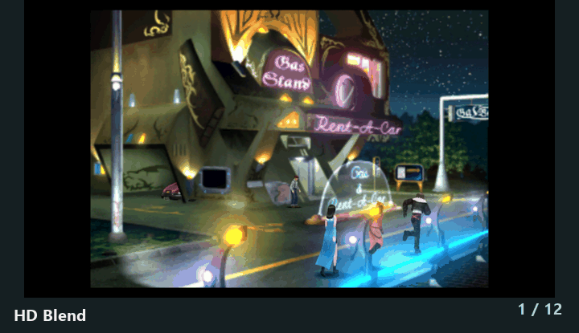

# FF8 Reborn

**[Download the Windows installer](https://github.com/Faga250885/FF8-Reborn/releases/latest/download/FF8-Reborn-Setup.exe)** · [Leer en español](README.es.md) · [Screenshot gallery](docs/GALLERY.md)

FF8 Reborn is a free visual mod for **FINAL FANTASY VIII Remastered** on Steam. Choose the original frame rate or target 60 or 120 FPS, widen the view in battle and on the world map, and tune the way character models blend into prerendered backgrounds. Change the settings while playing.

[Browse all 16 screenshots at your own pace →](docs/GALLERY.md)

## Requirements

- A Windows PC and the Steam account that owns [FINAL FANTASY VIII Remastered (app 1026680)](https://store.steampowered.com/app/1026680/FINAL_FANTASY_VIII__REMASTERED/).
- The supported Windows Steam build with `FFVIII_EFIGS.dll`. The installer checks the engine and original audio DLL before making changes. The 2013 PC release and the original PlayStation game use different engines.
- Launch through Steam. At startup, the mod checks the active Steam app, license and account ownership. A borrowed copy or free-weekend session does not activate the mod. The download contains the mod only.
- For 120 FPS output, use a display capable of at least 120 Hz and select its high refresh rate in Windows. Actual frame delivery depends on the scene, GPU and display.

## Install and play

1. Install the game in Steam. Close the game and the FFVIII launcher.
2. Download **[FF8-Reborn-Setup.exe](https://github.com/Faga250885/FF8-Reborn/releases/latest/download/FF8-Reborn-Setup.exe)** from Releases and run it. This single installer contains the mod. You do not need a mod manager or Lossless Scaling.
3. Check **Game folder**. If needed, choose **Browse** and select the folder Steam opens under **Manage → Browse local files**.
4. Select your settings and click **Install with these settings**. The installer keeps a backup of the original audio DLL.
5. Launch the game from Steam. Press **F8** or **Select + Start** to open FF8 Reborn.

## What you can change

| Setting | What it does |
| --- | --- |
| Frame rate | **Original**, **60** or **120**. The mod draws intermediate frames for supported motion. Original animation timing and battle input windows still apply. Unsupported frames can fall back to their native presentation. |
| Aspect ratio | **Widescreen** expands the camera in battle and on the world map. **Original (4:3)** restores the original framing. |
| Blurred sidebars | In widescreen, fills the sides of fixed backgrounds with diffuse colors sampled from the current scene, including characters near the edges. |
| Full-screen map | Choose the **Original** map or the illustrated **Reborn** atlas. The full map is centered and keeps its proportions. |
| Screen filter | Choose a preset or edit resolution, pixelation, scanlines, RGB mask, glow, PS1 dithering and edge smoothing. Available controls depend on filter type. |

**FF8 Reborn (recommended)** combines a 320-line image with mild scanlines and dithering. **HD Blend** is for players who prefer a higher-resolution image. It compares nearby colors at two distances, softens abrupt color boundaries and limits brightness changes around fine details. Adjust **Edge smoothing** to taste. [Compare HD Blend, the original frame and the recommended filter](docs/GALLERY.md#hd-blend).

Other looks include **PS1 Digital**, **Soft CRT**, **PS1 · RGB Monitor**, **PS1 Backgrounds**, **PS1 · CRT TV**, **PS1 Sharp** and **Off**.

## Live menu and controls

| Action | Keyboard | XInput controller / Steam Input |
| --- | --- | --- |
| Open or close the panel | F8 | Select + Start (View + Menu on Xbox layouts) |
| Move through settings | Up / Down | D-pad or left stick up / down |
| Change a value or switch profile | Left / Right | D-pad or left stick left / right |
| Adjust a numeric value in larger steps | Shift + Left / Right | Hold right bumper while adjusting |
| Activate the highlighted action | Enter | A |
| Discard unsaved filter edits and close | Esc | B |

Display choices save as you adjust them. Filters have their own profiles. To make a personal filter, pick a starting profile, adjust it and choose **Create a custom copy**. If a copy already exists, **Save to my custom profile** replaces that one slot. While editing the saved copy, choose **Save my changes**. **Restore filter defaults** appears when the values differ from the base filter. The last selected filter is remembered.

## Update, uninstall and troubleshoot

- **Update:** close FFVIII and its launcher, then run the latest installer. Existing preferences are read on startup. Review the selections before applying.
- **Uninstall:** close the game and launcher, open the installer, select the game folder and click **Uninstall**. The installer verifies and restores the original DLL. Save files are not part of the installation.
- **F8 does nothing:** give the game window focus and launch through the Steam account that owns the game. On a controller, press both buttons together. For a pad without XInput, use a Steam Input gamepad layout.
- **Unexpected DLL or incompatible engine:** confirm the edition and game folder. Another mod using `libvgmstream.dll` can conflict. Remove that mod using its own instructions before installing FF8 Reborn.
- **Reporting a visual issue:** include the location, scene type, frame-rate target, aspect ratio and filter. A screenshot helps with a static defect. A short clip is more useful for movement or flicker. [Open an issue](https://github.com/Faga250885/FF8-Reborn/issues).

## Project

Created by **Faga12**. FF8 Reborn is an unofficial fan project. FINAL FANTASY VIII Remastered belongs to its respective rights holders. [Build from source](docs/BUILD.md) · [Release history and SHA-256 checksums](https://github.com/Faga250885/FF8-Reborn/releases).
