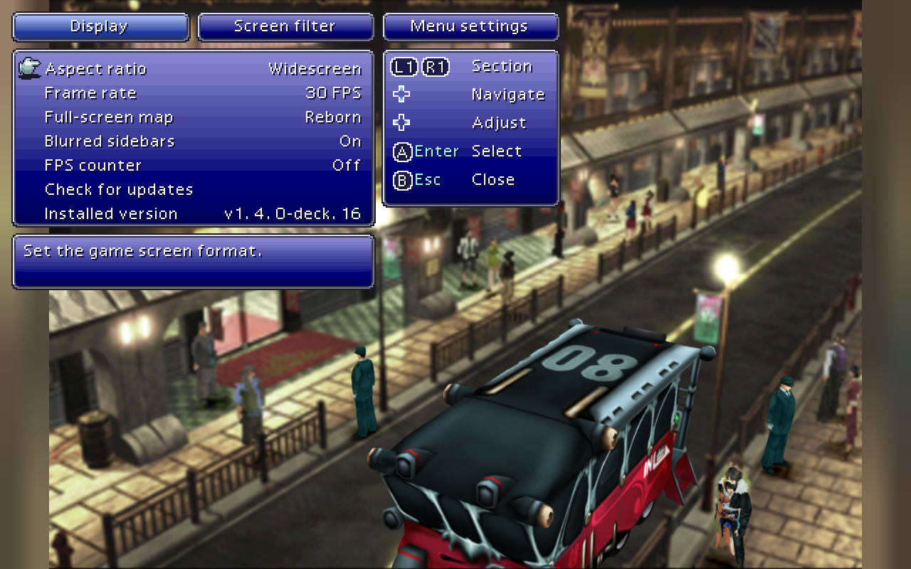
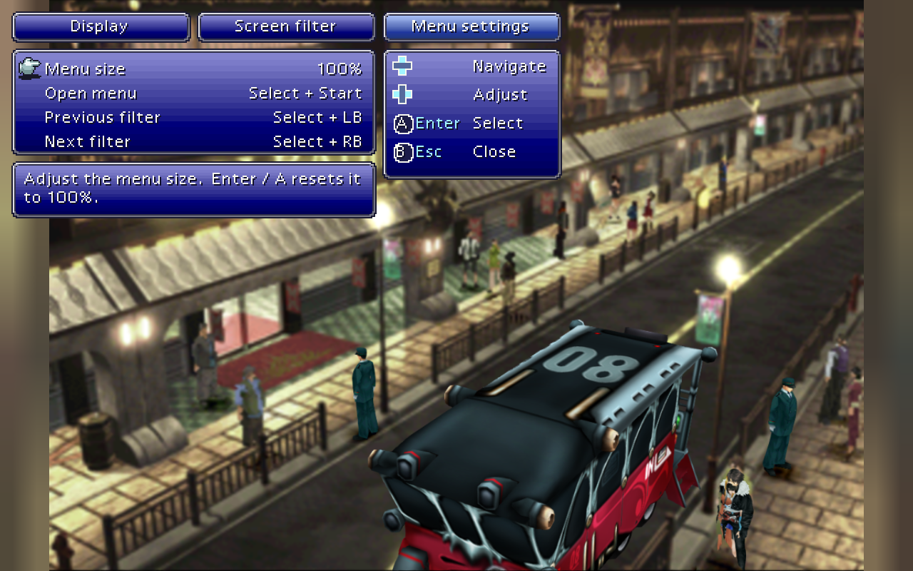

# FF8 Reborn

**[Download for Windows](https://github.com/Faga250885/FF8-Reborn/releases/latest/download/FF8-Reborn-Setup.exe)** · **[Download for Steam Deck](https://github.com/Faga250885/FF8-Reborn/releases/download/v1.4.0-deck.25/FF8-Reborn-Deck-Setup)** · [Leer en español](README.es.md) · [Screenshot gallery](docs/GALLERY.md)

> [!WARNING]
> **120 FPS and Widescreen are experimental.** Some scenes or effects can still show visual artifacts or miss the target frame rate. The original 4:3 framing and frame rate are available in the **Display** settings.

> [!NOTE]
> **Steam Deck is still in development.** On a physical Deck, playtesting has confirmed stable **30 FPS** in battles, towns and on the world map with the 30 FPS setting. **60 FPS is the next goal.** Development continues as time allows. There is no release date for that mode.

FF8 Reborn is a free visual mod for **FINAL FANTASY VIII Remastered** on Steam. Choose the original frame rate or target 30 FPS on Steam Deck and 30, 60, 90 or 120 FPS on Windows. Widen the view in battle and on the world map, and tune the way character models blend into prerendered backgrounds. Change the settings while playing.

**All six Steam game languages are supported.** The Reborn menu and its on-screen notices automatically follow the Steam launcher's language selection. [English, Español, Français, Deutsch, Italiano and 日本語](docs/GALLERY.md#menu-languages)

If F8 is unavailable in an older build when playing in Japanese, run the current installer to update.

**In active development.** If you find a bug, [report it on GitHub](https://github.com/Faga250885/FF8-Reborn/issues/new?template=bug.yml) or add a comment to an existing issue. Reports in English or Spanish are welcome.

## The in-game menu

Open the menu with **F8** or **Select + Start** and adjust settings while you play. The active section stays highlighted, and the pointing hand navigates the settings and the sections above. Click any image to open it at full size.

[Open the individual in-game screenshots at full size](docs/GALLERY.md#menu-languages)

**Display**

**Screen filter**

**Menu settings**

These previews use the current mod renderer over a captured game scene. See the [installer](#install-and-play) and the [update notification and in-game update screens](docs/GALLERY.md#settings-menu) for more images.

## Recent changes

- **Widescreen transitions and movies.** Scripted encounters keep the outgoing view until the battle canvas arrives. Movie scenes use the native composition for video, models and masks.
- **Widescreen battle HUD.** The countdown lines up with the turn gauges on the right. Shot's ammo counter and timer stay on the right, and Duel's combo list and timer use their respective edges.
- **Widescreen battle menus.** Names stay readable while the Blue Magic list slides between pages. The Windows test run covered all 16 Blue Magic spells and all 8 ammo types.
- **Battle limits and flashes.** Camera moves keep the arena covered when an intermediate frame would expose a seam. Full-screen shatter effects reach the widescreen edges. We checked the battle limits of all eleven playable characters on Windows.
- **Battle widescreen fixes.** The command cursor stays beside its text in timed battles. A charging GF's name, HP panel and gauge stay aligned, and full-screen flashes, distorted overlays and summon backgrounds extend to both edges. [Issue #2](https://github.com/Faga250885/FF8-Reborn/issues/2)
- **Automatic frame rate on Windows.** **Display → Frame rate** offers Auto, Original, 30, 60, 90 and 120 FPS. The 120 FPS target is experimental in both Auto and manual mode.
- **Battle zooms and camera turns.** Windows 1.4.22 interpolates 3D battle geometry using camera depth to prevent stretching caused by perspective in generated frames. Native battle poses and HUD layout are preserved.
- **Full language support.** Windows **v1.4.14** and Steam Deck **v1.4.0-deck.20** localize all three menu sections, filter labels, confirmations and on-screen notices. In Windows testing, F8 opened in all six languages and switching between widescreen and 4:3 took effect live on the world map. [View the language gallery](docs/GALLERY.md#menu-languages)
- **Classic settings menu.** The three sections sit across the top, with the active section highlighted. Press Up on the first option to move the hand to the section row, then Left or Right to choose and A or Enter to open. While navigating settings, L1 and R1 switch sections immediately. The controls panel shows directional-pad and button icons.
- **Automatic filter resolution.** Each preset chooses its signal resolution for the current game window. Use Left or Right to adjust it by 5 lines, or Enter / A to return to Auto. The nine percentage sliders move in 10-point steps.
- **Blurred sidebars.** Fixed a thin dark line where the left sidebar met the picture in prerendered fields at 1280×800. The mod now aligns the blur with the edge drawn by the game.
- **In-game updates on Windows and Steam Deck.** FF8 Reborn checks its platform's release channel once when the game starts. When a newer version is available, a matching blue notice appears in the upper left with a short Chocobo call. The call plays once for that version per game session. The notice stays for ten seconds and fades over two. Open **F8** or **Select + Start** to see the installed and available versions. Choose **Download update** when you want to install it.
- **Filters adapt to your game resolution.** The same profile adjusts its sampling and CRT pattern for Steam Deck at 720p/800p, Full HD at 1080p, QHD at 1440p and 4K at 2160p. **Screen filter → Output tuning** shows the active resolution. Each profile also has its own **Motion blur** strength, adjustable from 0% to 100% in steps of 10.
- **Steam Deck performance.** The 30 FPS mode uses native frames in towns and on the world map and interpolates battles. Physical Deck playtests confirmed stable 30 FPS in those scenes. The Deck version remains experimental, and 60 FPS is a development goal. Selected rendering optimizations also ship on Windows.
- **Widescreen battles and transitions.** Battle flashes reach both edges even when the game draws the flash in tiles. We verified this during the attack with Rinoa and Angelo in Galbadia. The EXP, items and ability-point pages use the available height and make room for active battle-assist icons. The scene holds its size as you enter Triple Triad. During camera movement, battle interpolation checks for triangles that stretch between separate combatants.

In 66 recorded battle frame pairs, the edge check flagged stretched triangles in 21 pairs with the previous renderer and zero after the change. The new renderer kept 99.1% of the vertices that previously received interpolated motion. The experience and item-results panels were measured in a live battle at 2560 × 1440.

In widescreen mode, both title screens fit the available height. On the black title screen, individually painted flames extend to both sides and fade with the original emblem. The white title background fills the width, and both logos keep their proportions. The memory-card selector and save list use the same proportional layout as the in-game menus.

## Gameplay video

[Watch the FF8 Reborn demo on YouTube](https://www.youtube.com/watch?v=dBUX5gA7oKM).

## Gameplay features

[See the full-size screenshots and frame-rate measurement](docs/GALLERY.md#features).

## Steam Deck (SteamOS, experimental)

| Frame rate | Towns and world map | Battles |
| --- | --- | --- |
| **Original** (default) | The game draws at its native pace, usually around 30 FPS. | The game draws combat at its native pace, usually around 15 FPS. |
| **30 FPS** | Uses the game's own frames at the same pace as Original, including the widescreen view. | Interpolates motion between compatible 15 FPS battle poses, targeting a new image every 33.3 ms. Combat inputs and animation timing follow the game clock. |

Menus and movies keep their native timing. Scene changes and battle frames that cannot be matched safely can hold the original image. In a recorded field with six characters, the mod skipped 414 of 447 geometry copies in one frame and preserved the complete image.

In a 42-second battle replay at 1280 × 800 on Windows, version 1.4.0-deck.4 submitted 30.00 frames/s. With simulated game work raised to 53 ms per battle update, it submitted 29.51 frames/s and the 99th-percentile interval reached 52.39 ms.

### Install or update on Steam Deck

If you have version **1.4.0-deck.1** or later, press **View + Menu → Check for updates → Download update**. When **Update ready** appears, close FFVIII and its launcher, then reopen the game. An existing **Original** selection is preserved. For a first install, follow the steps below.

1. Install **FINAL FANTASY VIII Remastered** from Steam. Close the game and its launcher.
2. Switch to Desktop Mode and download [FF8-Reborn-Deck-Setup](https://github.com/Faga250885/FF8-Reborn/releases/download/v1.4.0-deck.25/FF8-Reborn-Deck-Setup).
3. In Dolphin, right-click the downloaded file. Under **Properties → Permissions**, check **Is executable** and click **OK**.
4. Double-click the file and choose **Install**. When it finishes, return to Gaming Mode and launch FFVIII from Steam. Press **View + Menu** together to open the mod settings.

The installer finds registered Steam libraries, including microSD cards. If it asks you to locate a library, choose the folder containing `steamapps`. To remove the mod, close the game, reopen the installer and select **Uninstall**. The graphical installer uses Python 3.8+ and Zenity. A [command-line installer](https://github.com/Faga250885/FF8-Reborn/releases/download/v1.4.0-deck.25/FF8-Reborn-Deck.pyz) is also available.

If a release has just appeared and the menu says **Up to date**, compare **Display → Installed version** with the Deck release linked above. GitHub can take a few minutes to show the new release to the game. Select **Check for updates** again. When the row changes to **Download update**, press **A** again to download it. You can also close FFVIII and choose **Update or repair** in the Desktop Mode installer to update while keeping your settings.

To use just the filters, open the in-game panel with **View + Menu**. Set **Frame rate** to **Original**, **Aspect ratio** to **Original (4:3)** and **Full-screen map** to **Original**, then choose your screen filter.

## GOG for Windows

Setup recognizes the GOG edition. When both stores are detected, you can select the installation. The GOG 1.0.3 engine differs from Steam’s and still needs a renderer port and gameplay validation.

## Windows requirements

FF8 Reborn has no measured minimum GPU for 60 or 120 FPS. The 120 FPS target gives the CPU and GPU about 8.3 ms per output frame. Resolution and scene complexity matter. A 10-second world-map run on a Ryzen 5 7600X and RTX 5070 at 2560 × 1440 averaged 118.2 displayed FPS. [Frame-rate measurement](docs/GALLERY.md#frame-rate)

Windows 1.4.21 reduces framebuffer copies and reads both scene-validation samples together. In an RTX 5070 replay test, the median time to draw four intermediate frames in the same battle fell from **10.34 to 9.35 ms at 1080p** and from **9.71 to 8.77 ms at 4K**. These are renderer timings for a recorded scene. The field, world-map and battle comparisons at 1080p, 1440p and 4K produced identical color, depth and stencil data.

- A Windows PC and the Steam account that owns [FINAL FANTASY VIII Remastered (app 1026680)](https://store.steampowered.com/app/1026680/FINAL_FANTASY_VIII__REMASTERED/).
- The supported Windows Steam build with `FFVIII_EFIGS.dll`. The installer checks the engine and original audio DLL before making changes. The 2013 PC release and the original PlayStation game use different engines.
- Launch through Steam. At startup, the mod checks the active Steam app, license and account ownership. A borrowed copy or free-weekend session does not activate the mod. The download contains the mod only.
- For 120 FPS output, use a display capable of at least 120 Hz and select its high refresh rate in Windows. Actual frame delivery depends on the scene, GPU and display.

## Install and play

1. Install the game in Steam. Close the game and the FFVIII launcher.
2. Download **[FF8-Reborn-Setup.exe](https://github.com/Faga250885/FF8-Reborn/releases/latest/download/FF8-Reborn-Setup.exe)** from Releases and run it. This single installer contains the mod. You do not need a mod manager or Lossless Scaling.
3. Check **Game folder**. If needed, choose **Browse** and select the folder Steam opens under **Manage → Browse local files**.
4. Click **Install**. The installer keeps a backup of the original audio DLL.
5. Launch the game from Steam. Press **F8** or **Select + Start** to open FF8 Reborn.

[See the current menu, notifications and update screens](docs/GALLERY.md#settings-menu).

**Auto** is the default on a fresh Windows install. It targets **30 FPS** below 60 Hz, **60 FPS** from 60 Hz, **90 FPS** from 90 Hz and **120 FPS** from 120 Hz. A report of 59, 89 or 119 Hz counts as the corresponding nominal refresh rate. For example, a 75 Hz screen gets **Auto · 60 FPS** and a 144 Hz screen gets **Auto · 120 FPS**. If Windows cannot report the refresh rate, Auto uses 60 FPS. Auto follows the monitor the game is on. Existing manual choices stay saved, and you can select 120 FPS manually from the live menu.

Windows 1.4.1 uses a Steam Deck optimization that skips redundant OpenGL state changes when redrawing gameplay. Across nine recorded field, world-map and battle scenes, all 324 compared images matched in color, depth and stencil. In one 1080p battle on a GeForce RTX 5070, the median time to redraw a frame with a vertex buffer fell from 2.95 ms to 2.73 ms. The 60 FPS battle replay held its target. Battles at 120 FPS use the previous rendering path because it delivered steadier timing in repeated tests.

## What you can change

| Setting | What it does |
| --- | --- |
| Frame rate | **Auto**, **Original**, **30**, **60**, **90** or **120 (experimental)** on Windows, and **Original** or **30** on Deck. The mod draws intermediate frames for supported motion. Original animation timing and battle input windows still apply. Unsupported frames can fall back to their native presentation. |
| FPS counter | Show a pixel-font counter in the upper-left corner. Choose **Off** (default), **Small**, **Medium** or **Large**. It counts completed game-window swaps, including intermediate frames, and updates about twice per second. |
| Aspect ratio | **Widescreen (experimental)** expands the camera in battle and on the world map. **Original (4:3)** restores the original framing. |
| Blurred sidebars | Available across all prerendered fields in widescreen. Fills the side margins with diffuse colors from the current scene, including characters near the edges. Deling City is shown as an example. |
| Full-screen map | Choose the **Original** map or the illustrated **Reborn** atlas. The full map is centered and keeps its proportions. |
| Screen filter | Choose a preset or edit resolution, pixelation, scanlines, RGB mask, glow, PS1 dithering, edge smoothing and motion blur. Available controls depend on filter type. |

## Screen filters

Open **F8** or **Select + Start** and look at **Screen filter → Output tuning**. FF8 Reborn reads the game window's pixel dimensions and tunes the selected filter while you play. Resizing the window or docking a Steam Deck updates the tuning when the game's output size changes. Your chosen preset and saved Custom values carry across displays.

| Example game output | Internal tuning |
| --- | --- |
| 1280 × 720 or 1280 × 800 (Steam Deck) | 720p / 800p |
| 1920 × 1080 (Full HD) | 1080p |
| 2560 × 1440 (QHD) | 1440p (2K) |
| 3840 × 2160 (4K UHD) | 2160p (4K) |

View Output tuning in the 1280 × 800 settings panel

The line shows the actual game window size. The game selects by height, including on ultrawide displays. It switches to the next tier at 940, 1260 and 1800 pixels tall. For example, a 1920 × 1080 game window on a 4K monitor uses 1080p tuning. **Vertical resolution** controls the simulated signal and remains adjustable in every tier.

At 720p, 800p and 1080p, the standard CRT filter uses a gentler RGB mask, and the television filters keep their phosphor stripes wide enough to resolve. The 1440p tuning keeps the reference look. At 4K, the RGB pattern scales with the image and the filter samples a wider part of each simulated pixel.

Choose **Screen filter → Profile → Off** to turn off every screen-filter effect, including motion blur and TV simulation. Each profile selects its own rendering method. Inactive controls are dimmed and the cursor skips them.

Turn on **TV simulation** to adjust the three controls below it. **Screen pattern** selects the tube's pattern of colored phosphors, **Pattern strength** sets how visible it is and **Pattern sharpness** sets how soft or crisp it looks. The Sony Trinitron and both RCA factory presets start with TV simulation on. Other factory presets, including **HD Blend**, start with it off. Choose **Create a custom copy** or **Save my changes** to keep your combination.

**Vertical resolution** starts on **Auto**. The table shows the simulated signal height for each preset. PS1 Digital and the classic TV and monitor presets use the PlayStation’s 240-line non-interlaced mode as their reference. PS1 Sharp and HD Blend can resolve more detail on taller screens. [Sony PlayStation hardware manual, chapter 3](https://psx.arthus.net/sdk/Psy-Q/DOCS/Devrefs/Hardware.pdf).

| Filter | 720p | 800p (Deck) | 1080p | 1440p | 2160p |
| --- | ---: | ---: | ---: | ---: | ---: |
| PS1 Digital, PS1 · RGB Monitor, PS1 · CRT TV, Sony Trinitron, RCA Precision In-Line, RCA CT-100 | 240 | 240 | 240 | 240 | 240 |
| Soft CRT, PS1 Backgrounds, FF8 Reborn (recommended) | 240 | 265 | 320 | 320 | 320 |
| PS1 Sharp | 240 | 265 | 360 | 480 | 480 |
| HD Blend | 320 | 320 | 360 | 480 | 720 |

With **Vertical resolution** highlighted, press Left or Right to preview a manual setting between 120 and 720 in steps of 5. Press Enter or A on the same row to return to Auto. Choose **Create a custom copy** or **Save my changes** to keep the adjustment. Previously saved custom resolutions stay manual when you resize the window or change displays.

Three TV profiles model how an electron beam lights the tube. **Sony Trinitron KV-27FS100** uses continuous RGB stripes, **RCA Precision In-Line** uses staggered slots, and **RCA CT-100** uses triangular groups of phosphor dots. In the live panel, adjust **RGB mask** to change how visible the phosphors are and **Scanlines** to tune the space between illuminated lines. [Compare all three at full resolution](docs/GALLERY.md#televisions).

[Open the original 2560 × 1440 screenshots of every filter](docs/GALLERY.md#filters).

**FF8 Reborn (recommended)** combines mild scanlines and dithering with up to 320 simulated lines. **HD Blend** is for players who prefer a higher-resolution image. It compares nearby colors at two distances, softens abrupt color boundaries and limits brightness changes around fine details. Adjust **Edge smoothing** to taste. [Compare every preset outside the Galbadia Hotel](docs/GALLERY.md#hd-blend).

Other looks include **PS1 Digital**, **Soft CRT**, **PS1 · RGB Monitor**, **PS1 Backgrounds**, **PS1 · CRT TV**, **PS1 Sharp** and **Off**.

### Motion blur by filter

Under **Screen filter → Motion blur**, use Left/Right to adjust the strength live from **Off** to **100%** in steps of 10. The effect follows moving characters and camera pans in towns, on the world map and in battle. These values tune the look of each preset.

| Factory motion blur | Filter presets |
| --- | --- |
| Off | Off, PS1 Digital |
| 10% | PS1 · RGB Monitor, PS1 Sharp, HD Blend, Sony Trinitron KV-27FS100 |
| 20% | PS1 Backgrounds, FF8 Reborn (recommended), RCA Precision In-Line |
| 30% | Soft CRT, PS1 · CRT TV |
| 40% | RCA CT-100 |

## Live menu and controls

Open the menu with **F8** or **Select + Start**. Choose **Display** for game presentation, **Screen filter** for picture profiles or **Menu settings** for the size of the settings overlay. Adjust **Menu size** from 70% to 150% in steps of 10%. Press Enter or A on this row to return to 100%. The size changes live and is saved separately from filter profiles.

The in-game cursor uses the 16 × 16 hand from FFVI. The installer uses the desktop pointer and highlights the focused button. The update notice plays one 0.72-second call from FFVII. [FFVI menu sprite sheet](https://www.spriters-resource.com/snes/ff6/asset/54693/) · [FFVII Chocobo recording](https://ffc.rpgclassics.com/low/species/chocobo.shtml).

| Action | Keyboard | XInput controller / Steam Input |
| --- | --- | --- |
| Open the panel | F8 (fixed) | Hold Select and tap Start (View + Menu on Xbox controllers and Steam Deck) |
| Previous / next factory filter during gameplay | — | Hold Select and tap LB / RB (L1 / R1) |
| Focus the top sections and highlight the next / previous section | Tab / Shift + Tab | D-pad up from the first row, then left / right |
| Switch sections immediately while navigating settings | — | LB / RB (L1 / R1) |
| Open the highlighted section / return to the previous row | Enter / Esc | A / B |
| Move through settings | Up / Down | D-pad or left stick up / down |
| Change a value or switch profile | Left / Right | D-pad or left stick left / right |
| Activate the highlighted action | Enter | A |
| Close the panel or review unsaved filter changes | Esc | B |

**Select is the default shortcut modifier.** Keep it held while tapping LB or RB to compare looks. Each press changes one preset and briefly shows its name in the upper-left corner. Tap Start while still holding Select to open the menu. A standalone Select tap retains its normal game action on release.

Under **Menu settings**, highlight **Open menu**, **Previous filter** or **Next filter** and press A or Enter. Release the button used to start recording, then hold one or two controller buttons together for one second. Tap B or press Esc to cancel. Press Left on a shortcut row to restore its default. Each action has its own binding. F8 always opens the menu from the keyboard.

Percentage sliders move in 10-point steps with the keyboard or controller. An existing value such as 32% stays as saved until you adjust it. Right moves it to 40% and Left to 30%.

Display and menu settings save as you adjust them. Editing a filter shows **Custom (preview)**. Closing the panel with a pending edit lets you save it to **Custom**, discard it or keep editing. Choosing another profile with Left or Right discards the preview. Your last selected profile is remembered.

To keep your edits, choose **Create a custom copy**, **Save to my custom profile** or **Save my changes**, depending on whether you already have a saved copy. **Restore filter defaults** previews the base preset's values. You can test that look before deciding whether to save it.

[View the menu and filter controls at Steam Deck resolution](docs/GALLERY.md#settings-menu).

## Update, uninstall and troubleshoot

- **Update in-game.** Select **Download update** in **Display**. The progress bar shows the download, verification and saving stages. When **Update ready** appears, **Later** lets you keep playing. After saving your game, choose **Close game now**, then launch FFVIII again from Steam to apply the update. You can return to **Update ready** if you chose Later.
- **First upgrade from an older release.** Install Windows 1.4.0 or Steam Deck 1.4.0-deck.1 (or newer) once to add the menu option. Future updates use the Windows stable channel or the Steam Deck experimental channel automatically. Steam Deck updates work in Gaming Mode. Checking requires internet and downloading requires write access to the game folder. The standalone installer is also available for repairs.
- **Uninstall:** close the game and launcher, open the installer, select the game folder and click **Uninstall**. The installer verifies and restores the original DLL. Save files are not part of the installation.
- **F8 does nothing:** give the game window focus and launch through the Steam account that owns the game. On a controller, hold Select and tap Start or use your saved menu shortcut. For a pad without XInput, use a Steam Input gamepad layout.
- **Unexpected DLL or incompatible engine:** confirm the edition and game folder. Another mod using `libvgmstream.dll` can conflict. Remove that mod using its own instructions before installing FF8 Reborn.
- **Reporting a visual issue:** include the location, scene type, frame-rate target, aspect ratio and filter. A screenshot helps with a static defect. A short clip is more useful for movement or flicker. [Open an issue](https://github.com/Faga250885/FF8-Reborn/issues).

## Project

Created by **Faga12**. FF8 Reborn is an unofficial fan project. FINAL FANTASY VIII Remastered belongs to its respective rights holders. [Renderer source](src/) · [Installer source](installer/) · [Build and verify the download](docs/BUILD.md) · [Release history and SHA-256 checksums](https://github.com/Faga250885/FF8-Reborn/releases).

Menu typography uses **Reactor7** by Caveras under [CC BY-NC-SA 3.0](installer/Reactor7-LICENSE.txt).
