# Galería de juego

[FF8 Reborn](../README.es.md) · [English](GALLERY.md)

Capturas tomadas directamente en FFVIII Remastered de Steam con FF8 Reborn activo. Las vistas previas caben en esta página. Pulsa **Abrir original** para ver el JPG de Steam a 2560 × 1440. Si el navegador lo ajusta a la ventana, haz clic en la imagen con la lupa para verla al 100 %.

## Funciones generales

### Pantalla ancha

[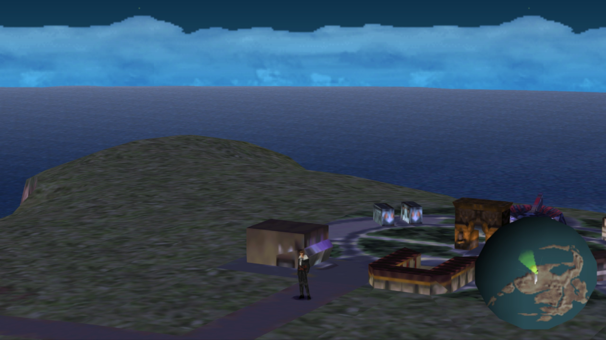](https://raw.githubusercontent.com/Faga250885/FF8-Reborn/v1.1.0/docs/images/widescreen.jpg)

La cámara del mapamundi en pantalla ancha.

[← Anterior](#fps-original) · [Abrir original · 2560 × 1440](https://raw.githubusercontent.com/Faga250885/FF8-Reborn/v1.1.0/docs/images/widescreen.jpg) · [Siguiente →](#battle)

### Batalla panorámica

Encuentro normal en Galbadia. El menú de comandos y el estado del grupo ocupan las esquinas opuestas de la vista panorámica.

[← Anterior](#widescreen) · [Abrir original · 2560 × 1440](https://raw.githubusercontent.com/Faga250885/FF8-Reborn/v1.1.0/docs/images/battle.jpg) · [Siguiente →](#frame-rate)

### Objetivo de 120 FPS

[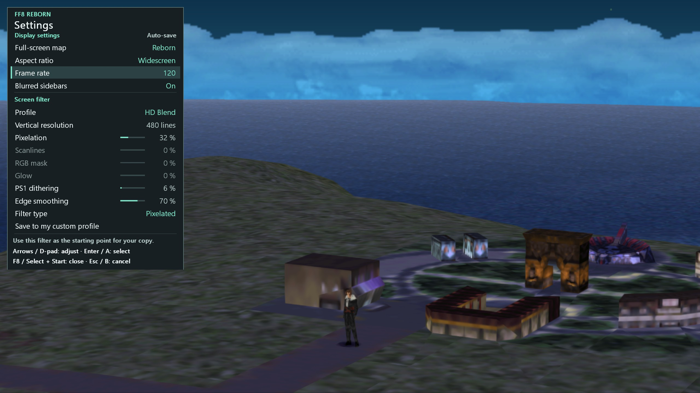](https://raw.githubusercontent.com/Faga250885/FF8-Reborn/v1.1.0/docs/images/frame-rate.jpg)

Una medición independiente de diez segundos con PresentMon en el mapamundi cerca de Deling a 2560 × 1440 registró 118,2 cuadros mostrados por segundo en este PC. La captura muestra el ajuste.

[← Anterior](#battle) · [Abrir original · 2560 × 1440](https://raw.githubusercontent.com/Faga250885/FF8-Reborn/v1.1.0/docs/images/frame-rate.jpg) · [Siguiente →](#atlas)

### Mapa ilustrado Reborn

[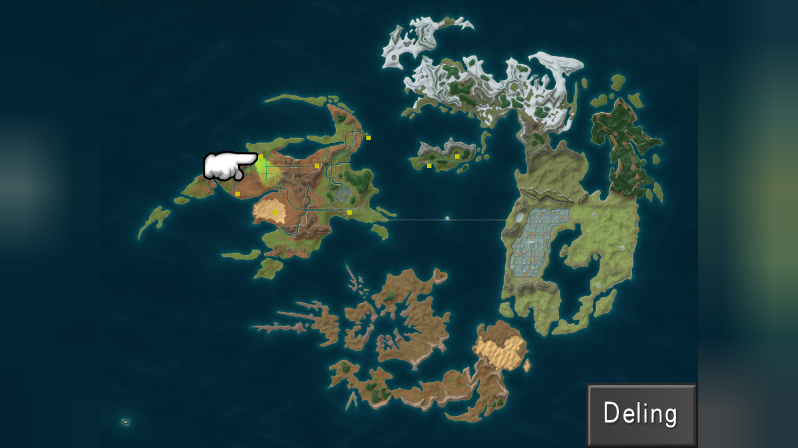](https://raw.githubusercontent.com/Faga250885/FF8-Reborn/v1.1.0/docs/images/atlas.jpg)

El atlas a pantalla completa conserva sus proporciones.

[← Anterior](#frame-rate) · [Abrir original · 2560 × 1440](https://raw.githubusercontent.com/Faga250885/FF8-Reborn/v1.1.0/docs/images/atlas.jpg) · [Siguiente →](#atlas-original)

### Mapa original

[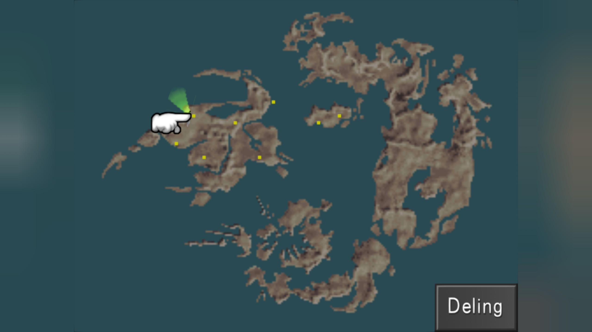](https://raw.githubusercontent.com/Faga250885/FF8-Reborn/v1.1.0/docs/images/atlas-original.jpg)

El diseño original del juego en la vista del mapamundi a pantalla completa.

[← Anterior](#atlas) · [Abrir original · 2560 × 1440](https://raw.githubusercontent.com/Faga250885/FF8-Reborn/v1.1.0/docs/images/atlas-original.jpg) · [Siguiente →](#mini-map)

### Minimapa

[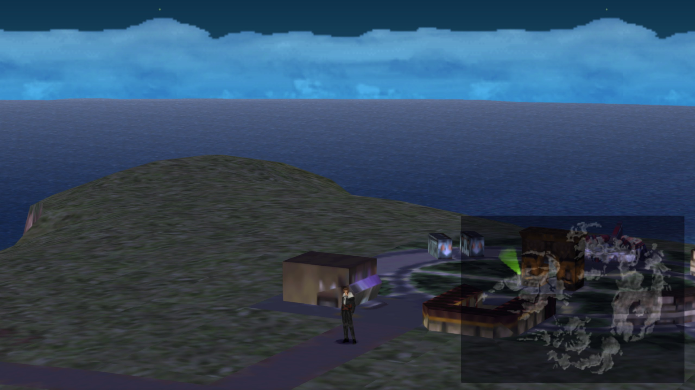](https://raw.githubusercontent.com/Faga250885/FF8-Reborn/v1.1.0/docs/images/mini-map.jpg)

El minimapa se alinea a la derecha durante la exploración.

[← Anterior](#atlas-original) · [Abrir original · 2560 × 1440](https://raw.githubusercontent.com/Faga250885/FF8-Reborn/v1.1.0/docs/images/mini-map.jpg) · [Siguiente →](#sides-on)

### Laterales difuminados activados

[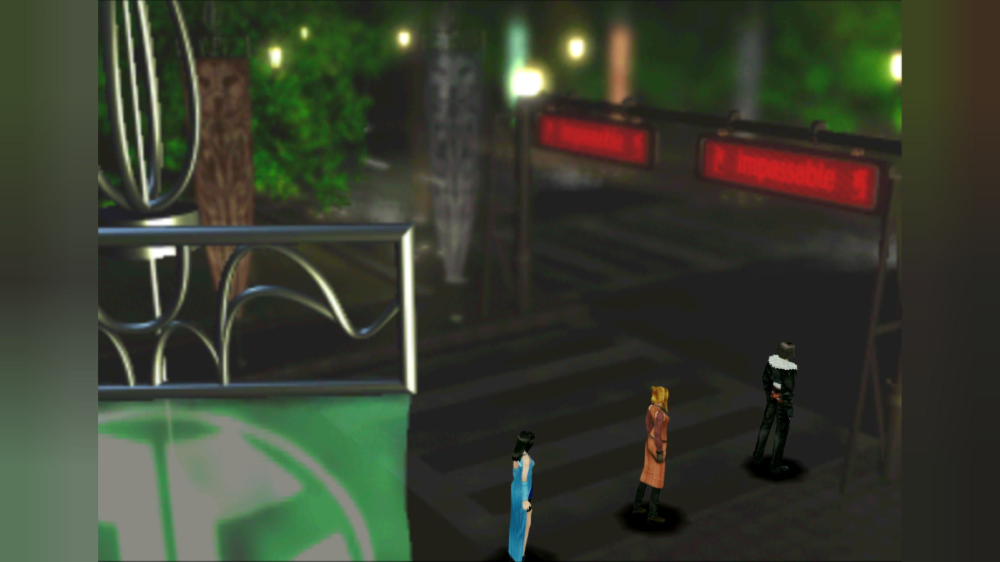](https://raw.githubusercontent.com/Faga250885/FF8-Reborn/v1.1.0/docs/images/sides-on.jpg)

Disponible en todos los escenarios prerenderizados en pantalla ancha. Esta calle es un ejemplo.

[← Anterior](#mini-map) · [Abrir original · 2560 × 1440](https://raw.githubusercontent.com/Faga250885/FF8-Reborn/v1.1.0/docs/images/sides-on.jpg) · [Siguiente →](#sides-off)

### Laterales difuminados desactivados

[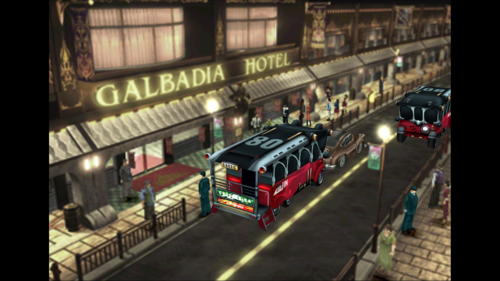](https://raw.githubusercontent.com/Faga250885/FF8-Reborn/v1.1.0/docs/images/sides-off.jpg)

El escenario con el relleno lateral desactivado.

[← Anterior](#sides-on) · [Abrir original · 2560 × 1440](https://raw.githubusercontent.com/Faga250885/FF8-Reborn/v1.1.0/docs/images/sides-off.jpg) · [Siguiente →](#classic)

### Formato original 4:3

[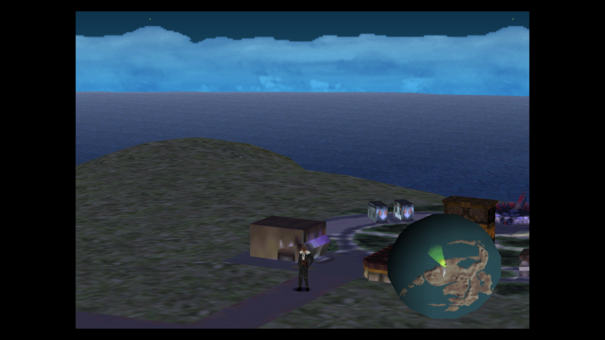](https://raw.githubusercontent.com/Faga250885/FF8-Reborn/v1.1.0/docs/images/classic.jpg)

El encuadre original en el mismo tramo de carretera.

[← Anterior](#sides-off) · [Abrir original · 2560 × 1440](https://raw.githubusercontent.com/Faga250885/FF8-Reborn/v1.1.0/docs/images/classic.jpg) · [Siguiente →](#fps-60)

### Objetivo de 60 FPS

El panel en vivo con el objetivo en 60.

[← Anterior](#classic) · [Abrir original · 2560 × 1440](https://raw.githubusercontent.com/Faga250885/FF8-Reborn/v1.1.0/docs/images/fps-60.jpg) · [Siguiente →](#fps-original)

### FPS originales

El ajuste Original presenta los cuadros a la cadencia del juego.

[← Anterior](#fps-60) · [Abrir original · 2560 × 1440](https://raw.githubusercontent.com/Faga250885/FF8-Reborn/v1.1.0/docs/images/fps-original.jpg) · [Siguiente →](#widescreen)

## Filtros gráficos

### Fósforos de televisor

Los tres PNG se renderizaron con el sombreador OpenGL del mod a partir de la misma captura del hotel sin filtrar. Ábrelos al 100 % para apreciar el patrón del fósforo. El haz se ensancha en las zonas luminosas. En pantallas de menor resolución se atenúa el detalle más fino para evitar franjas falsas. Son aproximaciones visuales de estos tubos. El enfoque, el brillo y el desgaste variaban entre televisores.

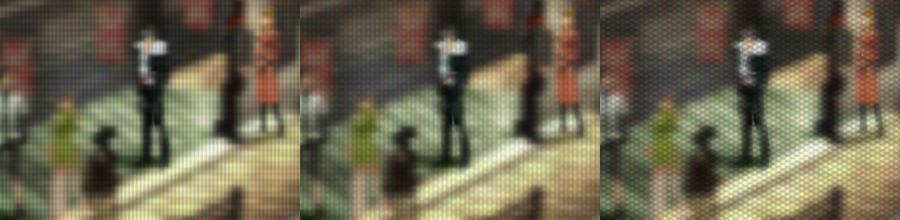

| Televisor | Estructura del fósforo | Muestra a 2560 × 1440 |
| --- | --- | --- |
| Sony Trinitron KV-27FS100 | Franjas RGB verticales continuas | [Abrir PNG](https://raw.githubusercontent.com/Faga250885/FF8-Reborn/v1.3.0/docs/images/trinitron.png) |
| RCA Precision In-Line | Ranuras verticales interrumpidas y escalonadas | [Abrir PNG](https://raw.githubusercontent.com/Faga250885/FF8-Reborn/v1.3.0/docs/images/rca-inline.png) |
| RCA CT-100 | Puntos RGB redondeados en grupos triangulares | [Abrir PNG](https://raw.githubusercontent.com/Faga250885/FF8-Reborn/v1.3.0/docs/images/rca-dot.png) |

Referencias de los tubos: [documentación del Sony](https://www.sony.com/electronics/support/product/KV-27FS100/manuals), [revista técnica de RCA](https://www.worldradiohistory.com/ARCHIVE-RCA/RCA-Engineer/1974-06-07.pdf) y [manual de servicio del RCA CT-100](https://www.earlytelevision.org/pdf/rca_ctc2_service_data.pdf).

Un mismo encuadre frente al Hotel Galbadia, en Deling, con el panel cerrado. Personalizado guarda los ajustes de cada jugador.

**Originales a 2560 × 1440**

[Off](https://raw.githubusercontent.com/Faga250885/FF8-Reborn/v1.1.0/docs/images/off.jpg) · [PS1 Digital](https://raw.githubusercontent.com/Faga250885/FF8-Reborn/v1.1.0/docs/images/digital.jpg) · [Soft CRT](https://raw.githubusercontent.com/Faga250885/FF8-Reborn/v1.1.0/docs/images/soft.jpg) · [PS1 · RGB Monitor](https://raw.githubusercontent.com/Faga250885/FF8-Reborn/v1.1.0/docs/images/rgb.jpg) · [PS1 Backgrounds](https://raw.githubusercontent.com/Faga250885/FF8-Reborn/v1.1.0/docs/images/backgrounds.jpg) · [PS1 · CRT TV](https://raw.githubusercontent.com/Faga250885/FF8-Reborn/v1.1.0/docs/images/tv.jpg) · [PS1 Sharp](https://raw.githubusercontent.com/Faga250885/FF8-Reborn/v1.1.0/docs/images/sharp.jpg) · [HD Blend](https://raw.githubusercontent.com/Faga250885/FF8-Reborn/v1.1.0/docs/images/hd-blend.jpg) · [FF8 Reborn (recommended)](https://raw.githubusercontent.com/Faga250885/FF8-Reborn/v1.1.0/docs/images/recommended.jpg)

### Off

[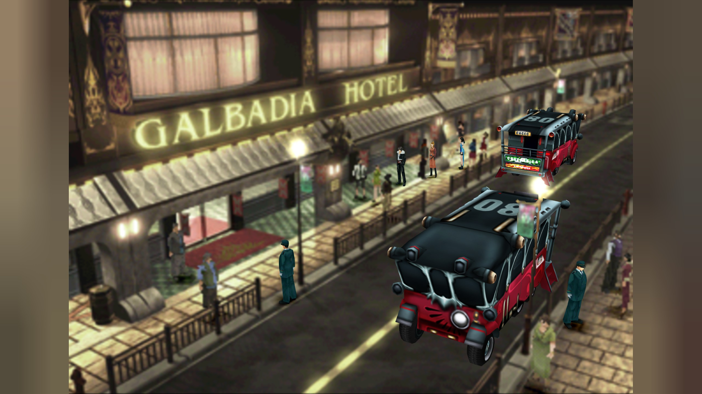](https://raw.githubusercontent.com/Faga250885/FF8-Reborn/v1.1.0/docs/images/off.jpg)

Referencia sin filtro.

[← Anterior](#recommended) · [Abrir original · 2560 × 1440](https://raw.githubusercontent.com/Faga250885/FF8-Reborn/v1.1.0/docs/images/off.jpg) · [Siguiente →](#digital)

### PS1 Digital

240 líneas con tramado intenso.

[← Anterior](#off) · [Abrir original · 2560 × 1440](https://raw.githubusercontent.com/Faga250885/FF8-Reborn/v1.1.0/docs/images/digital.jpg) · [Siguiente →](#soft)

### Soft CRT

[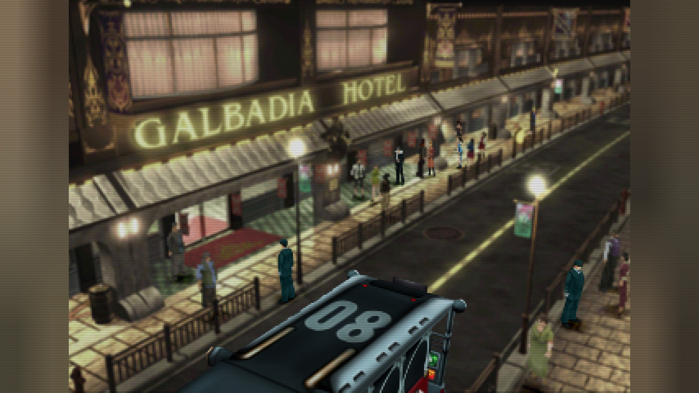](https://raw.githubusercontent.com/Faga250885/FF8-Reborn/v1.1.0/docs/images/soft.jpg)

Cuadrícula suave con líneas de barrido y algo de resplandor.

[← Anterior](#digital) · [Abrir original · 2560 × 1440](https://raw.githubusercontent.com/Faga250885/FF8-Reborn/v1.1.0/docs/images/soft.jpg) · [Siguiente →](#rgb)

### PS1 · RGB Monitor

[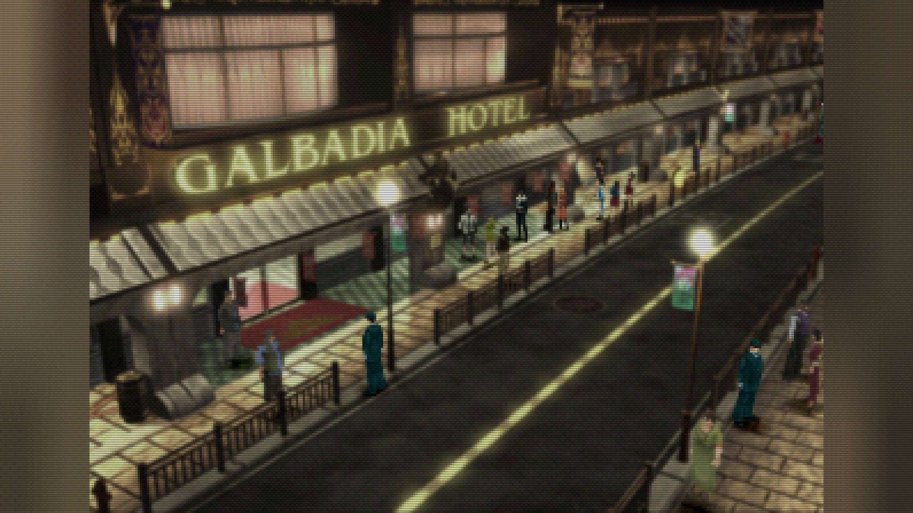](https://raw.githubusercontent.com/Faga250885/FF8-Reborn/v1.1.0/docs/images/rgb.jpg)

Las líneas de barrido más intensas de estos perfiles.

[← Anterior](#soft) · [Abrir original · 2560 × 1440](https://raw.githubusercontent.com/Faga250885/FF8-Reborn/v1.1.0/docs/images/rgb.jpg) · [Siguiente →](#backgrounds)

### PS1 Backgrounds

Imagen a baja resolución con contornos suavizados.

[← Anterior](#rgb) · [Abrir original · 2560 × 1440](https://raw.githubusercontent.com/Faga250885/FF8-Reborn/v1.1.0/docs/images/backgrounds.jpg) · [Siguiente →](#tv)

### PS1 · CRT TV

240 líneas con líneas de barrido y resplandor suaves.

[← Anterior](#backgrounds) · [Abrir original · 2560 × 1440](https://raw.githubusercontent.com/Faga250885/FF8-Reborn/v1.1.0/docs/images/tv.jpg) · [Siguiente →](#sharp)

### PS1 Sharp

Captura a 360 líneas. El perfil actual parte de 320.

[← Anterior](#tv) · [Abrir original · 2560 × 1440](https://raw.githubusercontent.com/Faga250885/FF8-Reborn/v1.1.0/docs/images/sharp.jpg) · [Siguiente →](#hd-blend)

### HD Blend

Captura a 480 líneas. El perfil actual parte de 320.

[← Anterior](#sharp) · [Abrir original · 2560 × 1440](https://raw.githubusercontent.com/Faga250885/FF8-Reborn/v1.1.0/docs/images/hd-blend.jpg) · [Siguiente →](#recommended)

### FF8 Reborn (recommended)

El perfil CRT recomendado de 320 líneas.

[← Anterior](#hd-blend) · [Abrir original · 2560 × 1440](https://raw.githubusercontent.com/Faga250885/FF8-Reborn/v1.1.0/docs/images/recommended.jpg) · [Siguiente →](#off)
