# Galería de capturas

[FF8 Reborn](../README.es.md) · [English](GALLERY.md)

Las comparaciones de filtros usan fotogramas guardados del juego procesados por el mod. Los ejemplos de pantalla ancha, mapa y difuminado son capturas de juego.

## 01 · HD Blend

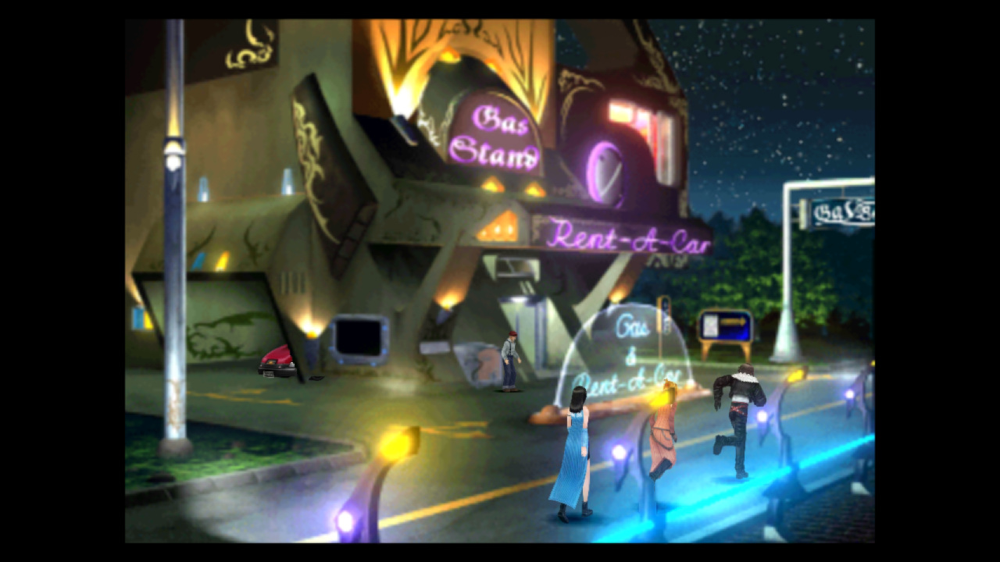

El filtro HD Blend sobre una calle prerenderizada. Fíjate en el contorno del personaje en primer plano.

[← Anterior](#world-hd) · [Ver a tamaño completo](images/hd-blend.jpg) · [Siguiente →](#field-original)

## 02 · Escenario original

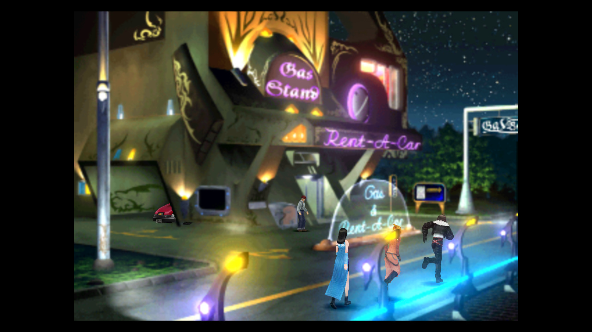

El mismo fotograma con el filtro apagado.

[← Anterior](#hd-blend) · [Ver a tamaño completo](images/field-original.jpg) · [Siguiente →](#recommended)

## 03 · FF8 Reborn (recomendado)

El aspecto CRT predeterminado de 320 líneas en el mismo fotograma.

[← Anterior](#field-original) · [Ver a tamaño completo](images/recommended.jpg) · [Siguiente →](#sharp)

## 04 · PS1 Sharp

Compara el pelo, la ropa y las letras de neón con las tres primeras vistas.

[← Anterior](#recommended) · [Ver a tamaño completo](images/sharp.jpg) · [Siguiente →](#soft-crt)

## 05 · Soft CRT

Líneas de barrido y máscara de fósforo sobre la misma calle.

[← Anterior](#sharp) · [Ver a tamaño completo](images/soft-crt.jpg) · [Siguiente →](#battle-wide)

## 06 · Batalla panorámica

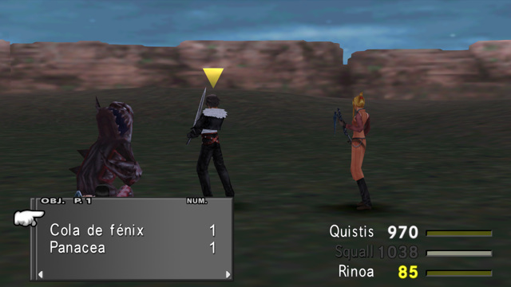

La lista de objetos se ancla a la izquierda y el estado del grupo a la derecha.

[← Anterior](#soft-crt) · [Ver a tamaño completo](images/battle-wide.jpg) · [Siguiente →](#world-wide)

## 07 · Mapamundi panorámico

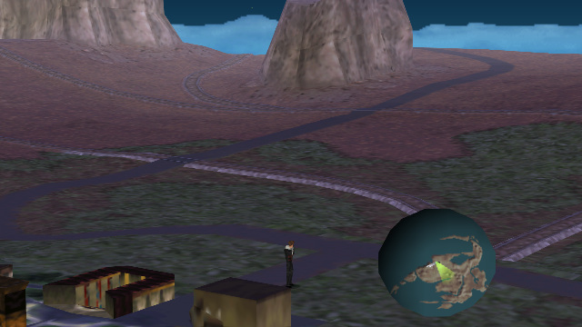

Exploración con el minimapa circular en el borde derecho.

[← Anterior](#battle-wide) · [Ver a tamaño completo](images/world-wide.jpg) · [Siguiente →](#world-overlay)

## 08 · Mapa superpuesto

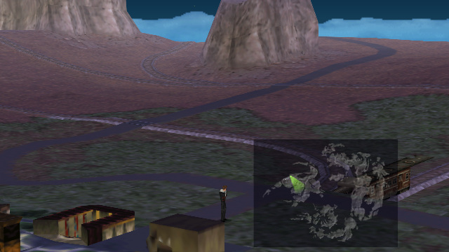

La segunda vista del minimapa se alinea también a la derecha.

[← Anterior](#world-wide) · [Ver a tamaño completo](images/world-overlay.jpg) · [Siguiente →](#atlas)

## 09 · Mapa HD a pantalla completa

El mapa centrado conserva sus proporciones. El cursor señala Deling.

[← Anterior](#world-overlay) · [Ver a tamaño completo](images/atlas.jpg) · [Siguiente →](#hall)

## 10 · Difuminado lateral en un pasillo

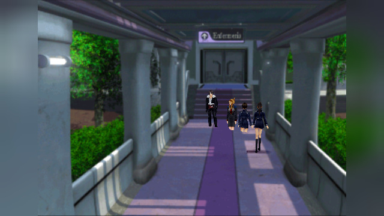

Los laterales toman sus colores de la escena visible.

[← Anterior](#atlas) · [Ver a tamaño completo](images/hall.jpg) · [Siguiente →](#infirmary)

## 11 · Difuminado lateral en la enfermería

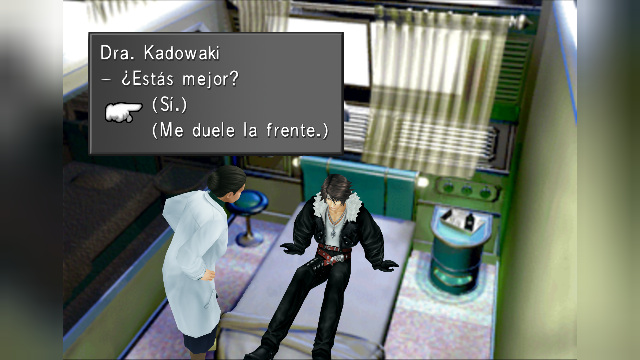

En una sala más luminosa se aprecia cómo el efecto cambia con la escena.

[← Anterior](#hall) · [Ver a tamaño completo](images/infirmary.jpg) · [Siguiente →](#menu)

## 12 · Menú de ajustes en vivo

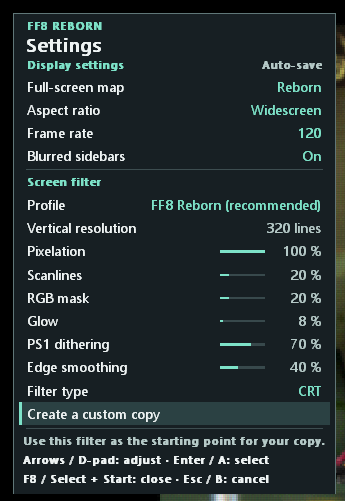

Abre el panel con F8 o Select + Start. Los ajustes de pantalla y los perfiles del filtro son independientes.

[← Anterior](#infirmary) · [Ver a tamaño completo](images/settings.png) · [Siguiente →](#installer)

## 13 · Instalador para Windows

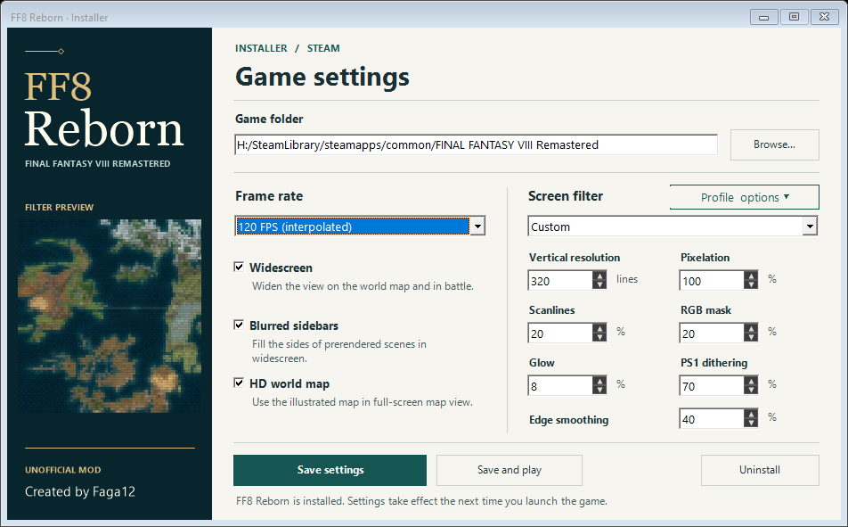

El instalador reúne los ajustes de pantalla, el filtro y su vista previa en una sola pantalla.

[← Anterior](#menu) · [Ver a tamaño completo](images/installer.png) · [Siguiente →](#battle-crt)

## 14 · Televisor CRT en batalla

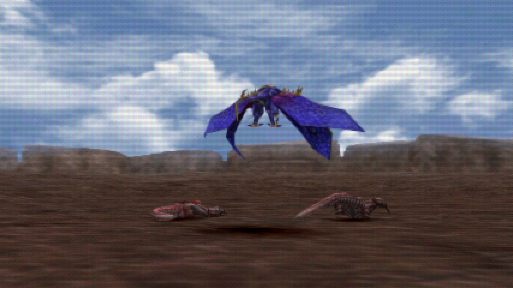

El perfil PS1 · CRT TV aplicado a una captura de batalla.

[← Anterior](#installer) · [Ver a tamaño completo](images/battle-crt.jpg) · [Siguiente →](#battle-digital)

## 15 · PS1 Digital en batalla

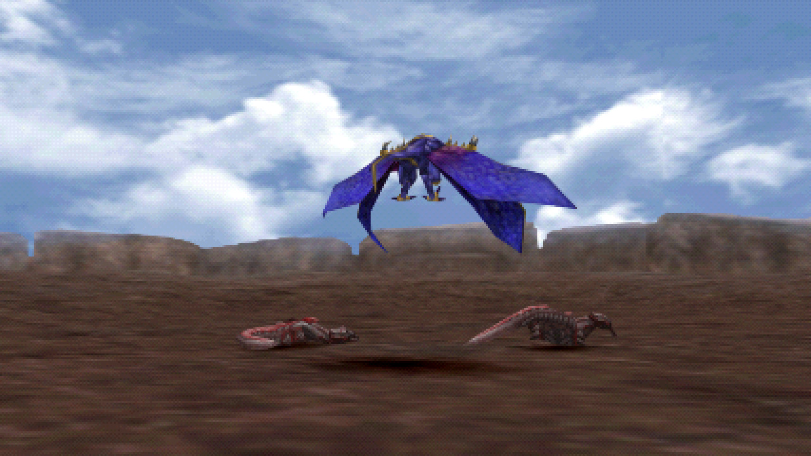

El mismo fotograma de batalla con la apariencia digital de PlayStation.

[← Anterior](#battle-crt) · [Ver a tamaño completo](images/battle-digital.jpg) · [Siguiente →](#world-hd)

## 16 · HD Blend en el mapamundi

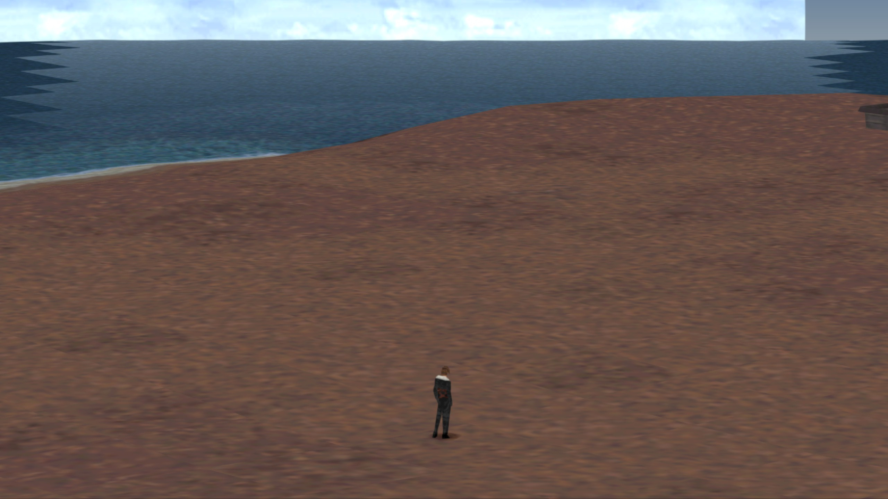

El filtro adaptativo aplicado a un fotograma de exploración.

[← Anterior](#battle-digital) · [Ver a tamaño completo](images/world-hd.jpg) · [Siguiente →](#hd-blend)
