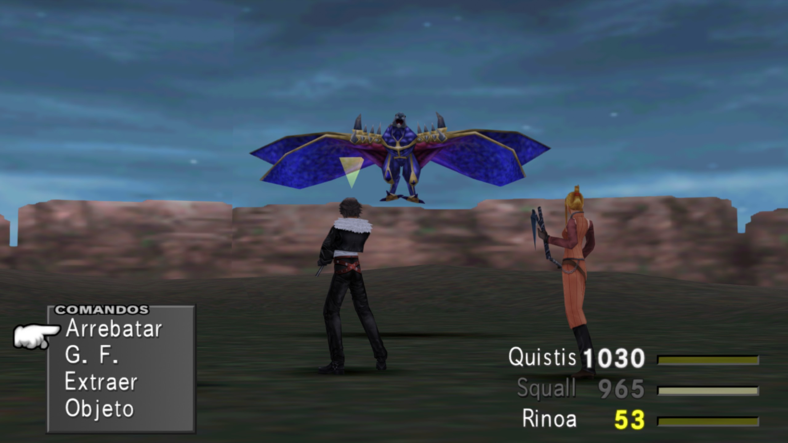
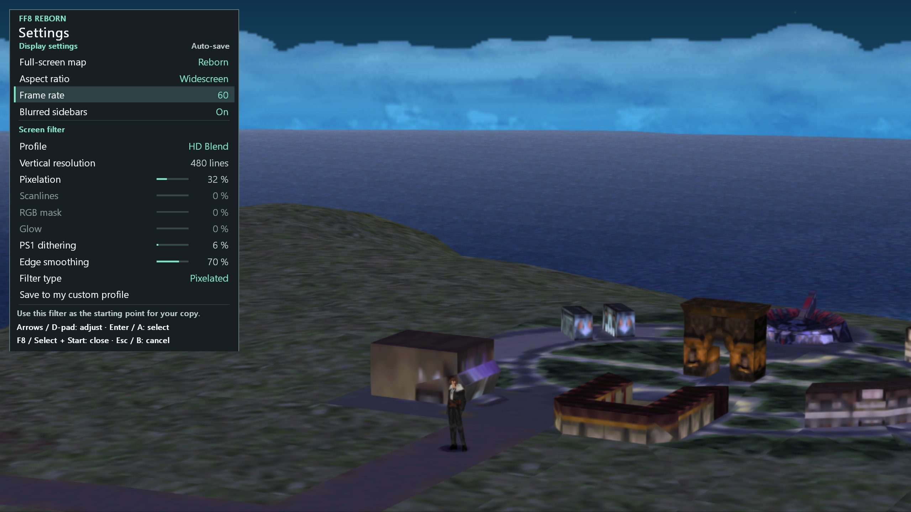
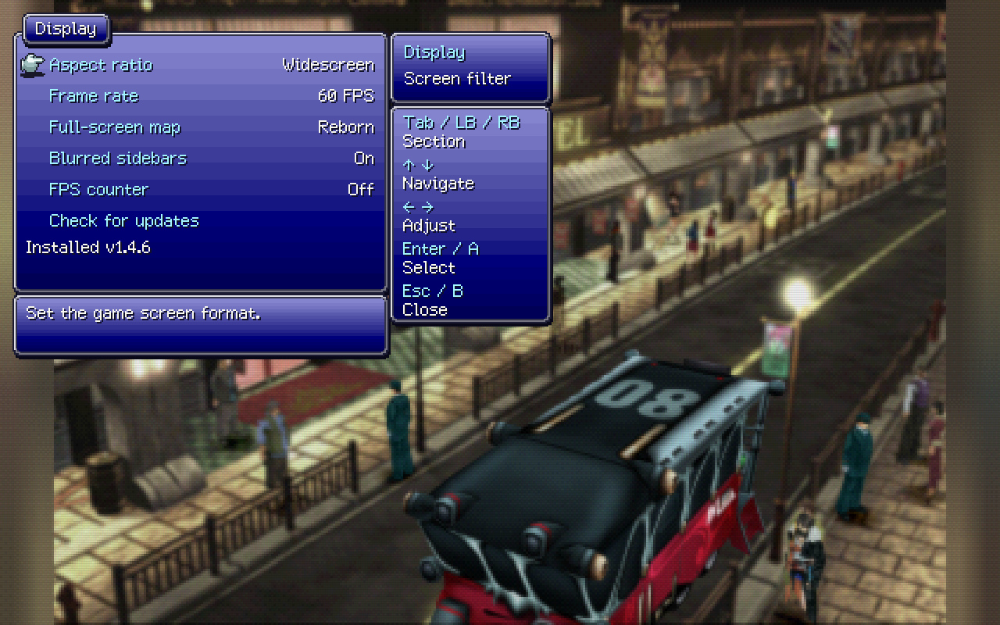
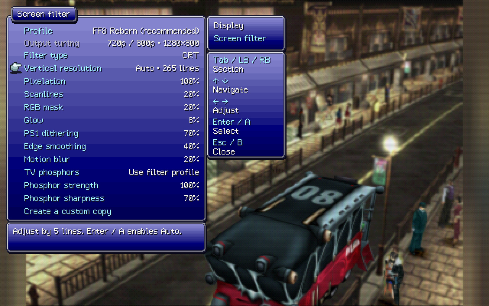
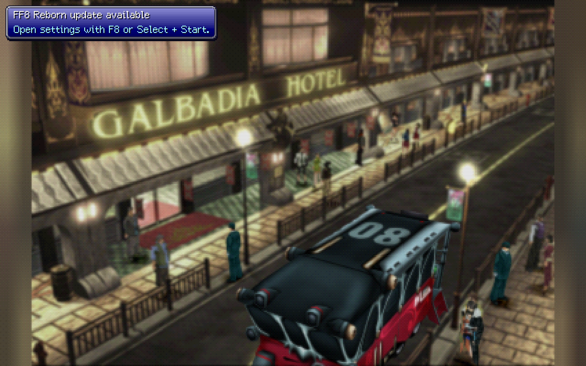
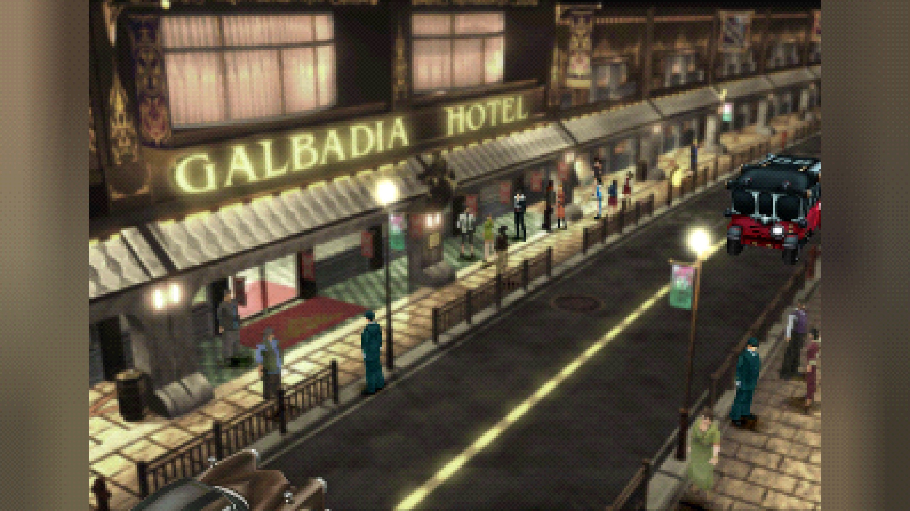
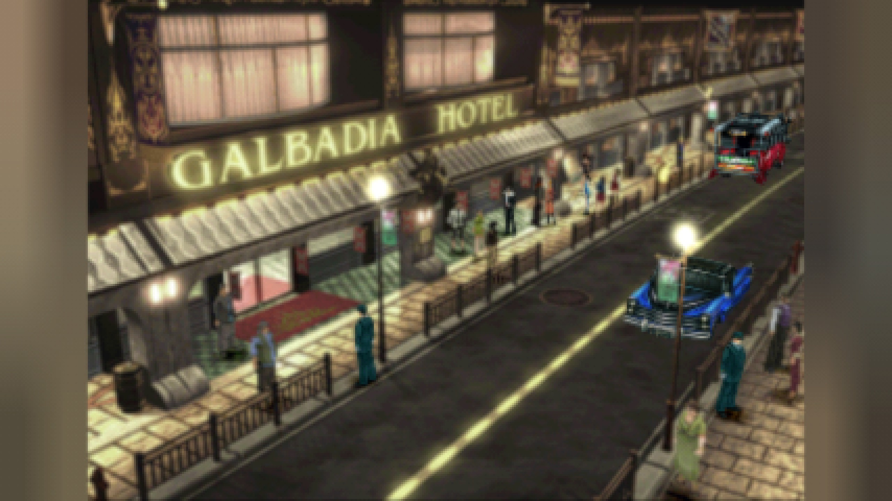
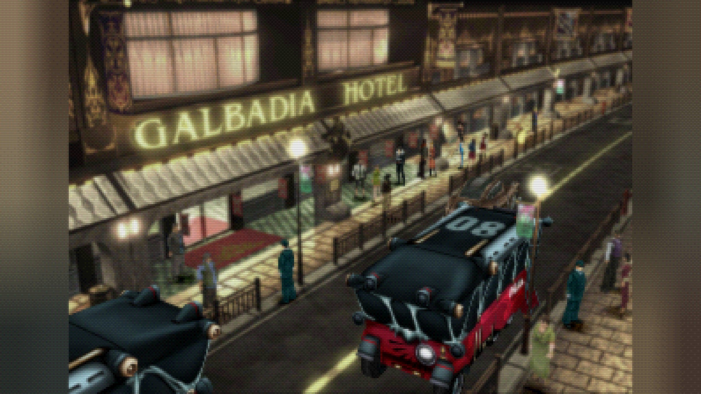

# Gameplay gallery

[FF8 Reborn](../README.md) · [Español](GALERIA.md)

The gameplay images come from the Steam edition of FFVIII Remastered. The settings previews show the current mod menu rendered over frames captured from the game. Open an image to inspect it at full size.

## Gameplay features

### Widescreen

World-map camera in widescreen.

[← Previous](#fps-original) · [Open original · 2560 × 1440](https://raw.githubusercontent.com/Faga250885/FF8-Reborn/v1.1.0/docs/images/widescreen.jpg) · [Next →](#battle)

### Widescreen battle

A regular encounter in Galbadia. The command menu and party status sit at opposite edges of the expanded battle view.

[← Previous](#widescreen) · [Open original · 2560 × 1440](https://raw.githubusercontent.com/Faga250885/FF8-Reborn/v1.1.0/docs/images/battle.jpg) · [Next →](#frame-rate)

### 120 FPS target

A separate 10-second PresentMon sample on the world map near Deling at 2560 × 1440 averaged 118.2 displayed frames/s on this PC. The still shows the setting.

[← Previous](#battle) · [Open original · 2560 × 1440](https://raw.githubusercontent.com/Faga250885/FF8-Reborn/v1.1.0/docs/images/frame-rate.jpg) · [Next →](#atlas)

### Reborn world map

The full-screen atlas keeps its proportions.

[← Previous](#frame-rate) · [Open original · 2560 × 1440](https://raw.githubusercontent.com/Faga250885/FF8-Reborn/v1.1.0/docs/images/atlas.jpg) · [Next →](#atlas-original)

### Original world map

The standard map artwork as shown in the full-screen world map.

[← Previous](#atlas) · [Open original · 2560 × 1440](https://raw.githubusercontent.com/Faga250885/FF8-Reborn/v1.1.0/docs/images/atlas-original.jpg) · [Next →](#mini-map)

### Compact map

The compact map sits at the right of the exploration view.

[← Previous](#atlas-original) · [Open original · 2560 × 1440](https://raw.githubusercontent.com/Faga250885/FF8-Reborn/v1.1.0/docs/images/mini-map.jpg) · [Next →](#sides-on)

### Blurred sidebars on

Available across all prerendered fields in widescreen. This street is one example.

[← Previous](#mini-map) · [Open original · 2560 × 1440](https://raw.githubusercontent.com/Faga250885/FF8-Reborn/v1.1.0/docs/images/sides-on.jpg) · [Next →](#sides-off)

### Blurred sidebars off

The field with the side fill switched off.

[← Previous](#sides-on) · [Open original · 2560 × 1440](https://raw.githubusercontent.com/Faga250885/FF8-Reborn/v1.1.0/docs/images/sides-off.jpg) · [Next →](#classic)

### Original 4:3

The original framing on the same stretch of road.

[← Previous](#sides-off) · [Open original · 2560 × 1440](https://raw.githubusercontent.com/Faga250885/FF8-Reborn/v1.1.0/docs/images/classic.jpg) · [Next →](#fps-60)

### 60 FPS target

The live panel with the target set to 60.

[← Previous](#classic) · [Open original · 2560 × 1440](https://raw.githubusercontent.com/Faga250885/FF8-Reborn/v1.1.0/docs/images/fps-60.jpg) · [Next →](#fps-original)

### Original frame rate

The menu uses the native game timing for presentation.

[← Previous](#fps-60) · [Open original · 2560 × 1440](https://raw.githubusercontent.com/Faga250885/FF8-Reborn/v1.1.0/docs/images/fps-original.jpg) · [Next →](#widescreen)

## Settings menu

**Display** groups screen options and the updater. **Screen filter** groups the active profile, its controls and the action for saving a custom copy. The blue windows and pointing hand follow the FFVI menu design. The 1280 × 800 examples show the street outside the Galbadia Hotel.

## Screen filters

### Television phosphors

The three PNGs below were rendered by the mod's OpenGL shader from the same unfiltered hotel capture. Open them at 100% to see the phosphor pattern. The beam widens in bright areas. At lower display resolutions, fine mask detail fades to reduce moiré. These are visual approximations of tube designs. Individual sets vary in focus, brightness and condition.

| Television | Phosphor structure | 2560 × 1440 preview |
| --- | --- | --- |
| Sony Trinitron KV-27FS100 | Continuous vertical RGB stripes | [Open PNG](https://raw.githubusercontent.com/Faga250885/FF8-Reborn/v1.3.0/docs/images/trinitron.png) |
| RCA Precision In-Line | Interrupted, staggered vertical slots | [Open PNG](https://raw.githubusercontent.com/Faga250885/FF8-Reborn/v1.3.0/docs/images/rca-inline.png) |
| RCA CT-100 | Rounded RGB dots arranged in triangular groups | [Open PNG](https://raw.githubusercontent.com/Faga250885/FF8-Reborn/v1.3.0/docs/images/rca-dot.png) |

Tube references include the [Sony model documentation](https://www.sony.com/electronics/support/product/KV-27FS100/manuals), [RCA Engineering](https://www.worldradiohistory.com/ARCHIVE-RCA/RCA-Engineer/1974-06-07.pdf) and the [RCA CT-100 service manual](https://www.earlytelevision.org/pdf/rca_ctc2_service_data.pdf).

Same camera position outside the Galbadia Hotel in Deling City, with the settings panel closed. Custom stores each player’s own settings.

**2560 × 1440 originals**

[Off](https://raw.githubusercontent.com/Faga250885/FF8-Reborn/v1.1.0/docs/images/off.jpg) · [PS1 Digital](https://raw.githubusercontent.com/Faga250885/FF8-Reborn/v1.1.0/docs/images/digital.jpg) · [Soft CRT](https://raw.githubusercontent.com/Faga250885/FF8-Reborn/v1.1.0/docs/images/soft.jpg) · [PS1 · RGB Monitor](https://raw.githubusercontent.com/Faga250885/FF8-Reborn/v1.1.0/docs/images/rgb.jpg) · [PS1 Backgrounds](https://raw.githubusercontent.com/Faga250885/FF8-Reborn/v1.1.0/docs/images/backgrounds.jpg) · [PS1 · CRT TV](https://raw.githubusercontent.com/Faga250885/FF8-Reborn/v1.1.0/docs/images/tv.jpg) · [PS1 Sharp](https://raw.githubusercontent.com/Faga250885/FF8-Reborn/v1.1.0/docs/images/sharp.jpg) · [HD Blend](https://raw.githubusercontent.com/Faga250885/FF8-Reborn/v1.1.0/docs/images/hd-blend.jpg) · [FF8 Reborn (recommended)](https://raw.githubusercontent.com/Faga250885/FF8-Reborn/v1.1.0/docs/images/recommended.jpg)

### Off

Unfiltered reference.

[← Previous](#recommended) · [Open original · 2560 × 1440](https://raw.githubusercontent.com/Faga250885/FF8-Reborn/v1.1.0/docs/images/off.jpg) · [Next →](#digital)

### PS1 Digital

240 lines with strong dithering.

[← Previous](#off) · [Open original · 2560 × 1440](https://raw.githubusercontent.com/Faga250885/FF8-Reborn/v1.1.0/docs/images/digital.jpg) · [Next →](#soft)

### Soft CRT

Soft pixel grid, scanlines and a little glow.

[← Previous](#digital) · [Open original · 2560 × 1440](https://raw.githubusercontent.com/Faga250885/FF8-Reborn/v1.1.0/docs/images/soft.jpg) · [Next →](#rgb)

### PS1 · RGB Monitor

The strongest scanlines among these presets.

[← Previous](#soft) · [Open original · 2560 × 1440](https://raw.githubusercontent.com/Faga250885/FF8-Reborn/v1.1.0/docs/images/rgb.jpg) · [Next →](#backgrounds)

### PS1 Backgrounds

Low-resolution image with softened edges.

[← Previous](#rgb) · [Open original · 2560 × 1440](https://raw.githubusercontent.com/Faga250885/FF8-Reborn/v1.1.0/docs/images/backgrounds.jpg) · [Next →](#tv)

### PS1 · CRT TV

240 lines, mild scanlines and glow.

[← Previous](#backgrounds) · [Open original · 2560 × 1440](https://raw.githubusercontent.com/Faga250885/FF8-Reborn/v1.1.0/docs/images/tv.jpg) · [Next →](#sharp)

### PS1 Sharp

Captured at 360 lines.

[← Previous](#tv) · [Open original · 2560 × 1440](https://raw.githubusercontent.com/Faga250885/FF8-Reborn/v1.1.0/docs/images/sharp.jpg) · [Next →](#hd-blend)

### HD Blend

Captured at 480 lines.

[← Previous](#sharp) · [Open original · 2560 × 1440](https://raw.githubusercontent.com/Faga250885/FF8-Reborn/v1.1.0/docs/images/hd-blend.jpg) · [Next →](#recommended)

### FF8 Reborn (recommended)

The recommended CRT preset, captured at 320 lines.

[← Previous](#hd-blend) · [Open original · 2560 × 1440](https://raw.githubusercontent.com/Faga250885/FF8-Reborn/v1.1.0/docs/images/recommended.jpg) · [Next →](#off)
