# Screenshot gallery

[FF8 Reborn](../README.md) · [Español](GALERIA.md)

The filter comparisons use saved game frames rendered through the mod. The widescreen, map and sidebar examples are gameplay captures.

## 01 · HD Blend

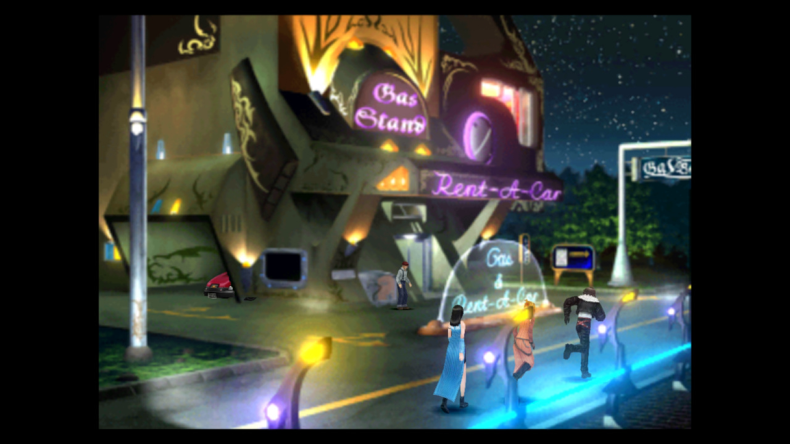

The HD Blend filter on a prerendered street. Watch the outline of the foreground character.

[← Previous](#world-hd) · [Open full size](images/hd-blend.jpg) · [Next →](#field-original)

## 02 · Original field image

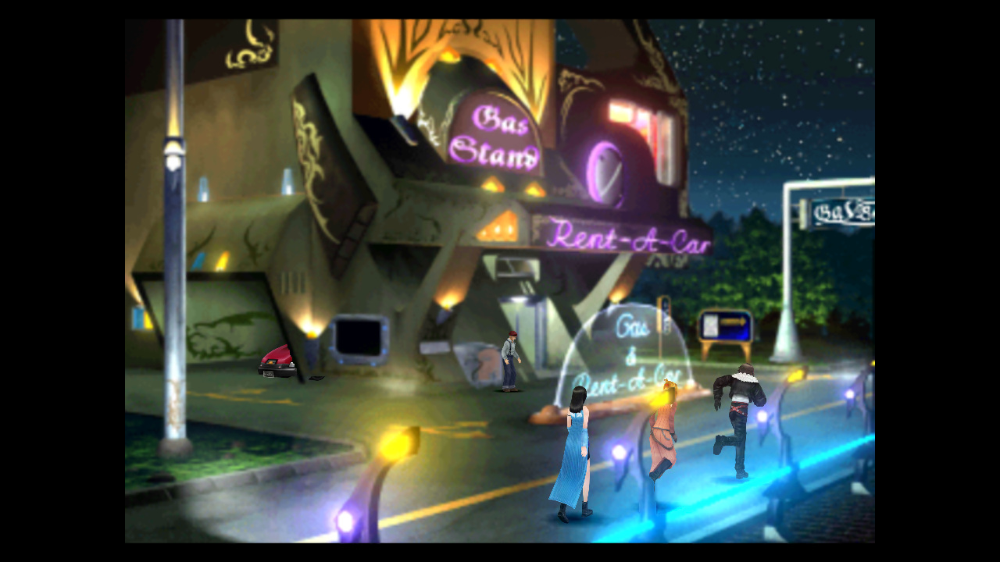

The same captured frame with the screen filter off.

[← Previous](#hd-blend) · [Open full size](images/field-original.jpg) · [Next →](#recommended)

## 03 · FF8 Reborn (recommended)

The default 320-line CRT look on the same frame.

[← Previous](#field-original) · [Open full size](images/recommended.jpg) · [Next →](#sharp)

## 04 · PS1 Sharp

Compare hair, clothing and neon lettering with the first three views.

[← Previous](#recommended) · [Open full size](images/sharp.jpg) · [Next →](#soft-crt)

## 05 · Soft CRT

Scanlines and phosphor mask over the same street.

[← Previous](#sharp) · [Open full size](images/soft-crt.jpg) · [Next →](#battle-wide)

## 06 · Widescreen battle

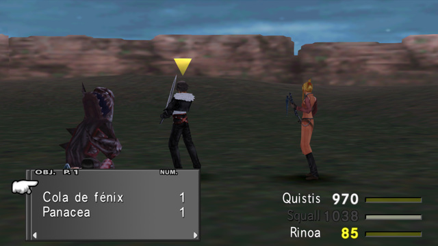

The item list follows the left edge and party status follows the right.

[← Previous](#soft-crt) · [Open full size](images/battle-wide.jpg) · [Next →](#world-wide)

## 07 · World map in widescreen

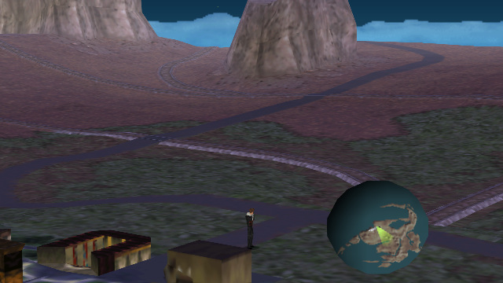

Exploration with the round minimap at the right edge.

[← Previous](#battle-wide) · [Open full size](images/world-wide.jpg) · [Next →](#world-overlay)

## 08 · Minimap overlay

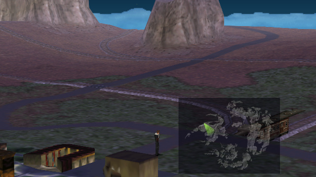

The second exploration map view uses the same right-hand anchor.

[← Previous](#world-wide) · [Open full size](images/world-overlay.jpg) · [Next →](#atlas)

## 09 · Full-screen HD map

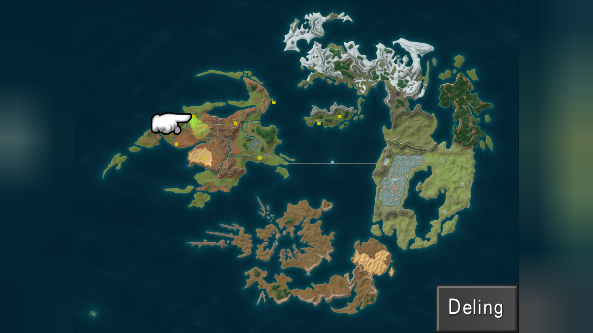

The centered world map keeps its proportions. The cursor marks Deling.

[← Previous](#world-overlay) · [Open full size](images/atlas.jpg) · [Next →](#hall)

## 10 · Blurred sidebars in a hallway

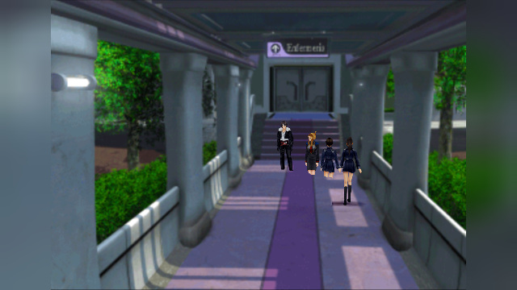

The sides take their colors from the current scene.

[← Previous](#atlas) · [Open full size](images/hall.jpg) · [Next →](#infirmary)

## 11 · Blurred sidebars in the infirmary

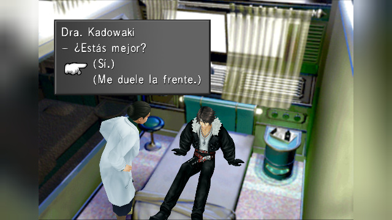

A brighter room shows how the same effect changes with the scene.

[← Previous](#hall) · [Open full size](images/infirmary.jpg) · [Next →](#menu)

## 12 · Live settings menu

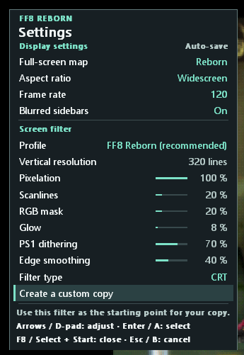

Open the panel with F8 or Select + Start. Display settings and filter profiles are independent.

[← Previous](#infirmary) · [Open full size](images/settings.png) · [Next →](#installer)

## 13 · Windows installer

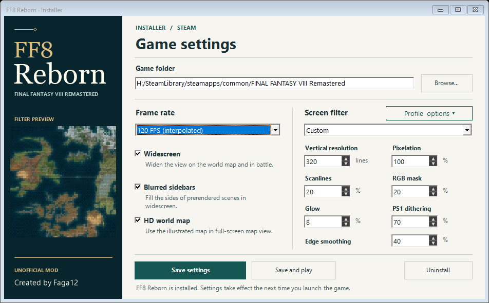

The installer shows the display options, the selected filter and its preview on one screen.

[← Previous](#menu) · [Open full size](images/installer.png) · [Next →](#battle-crt)

## 14 · CRT TV in battle

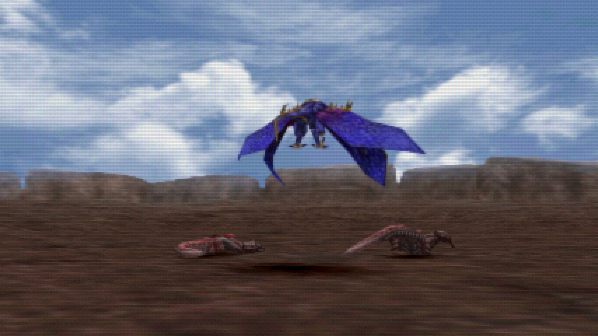

The PS1 · CRT TV profile applied to a battle capture.

[← Previous](#installer) · [Open full size](images/battle-crt.jpg) · [Next →](#battle-digital)

## 15 · PS1 Digital in battle

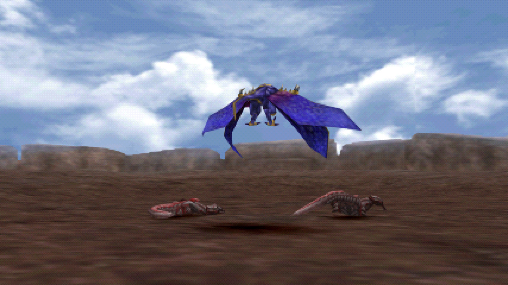

The same battle frame with the digital PlayStation look.

[← Previous](#battle-crt) · [Open full size](images/battle-digital.jpg) · [Next →](#world-hd)

## 16 · HD Blend on the world map

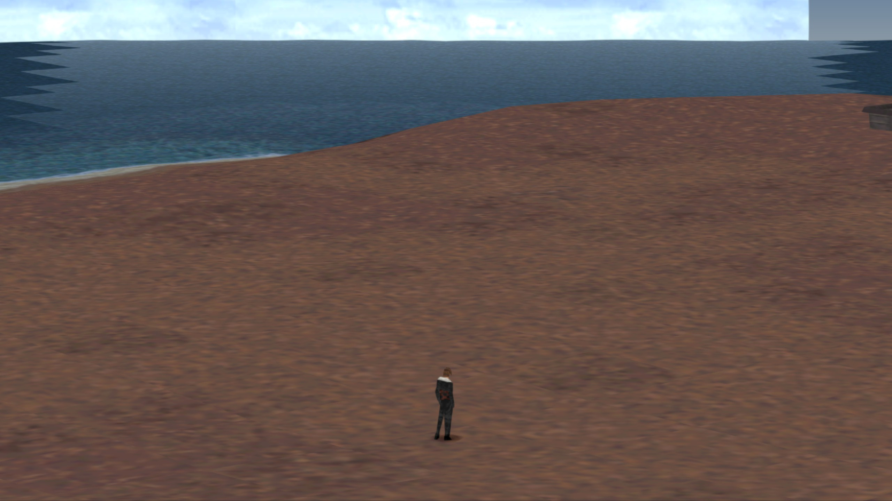

The adaptive filter applied to an exploration frame.

[← Previous](#battle-digital) · [Open full size](images/world-hd.jpg) · [Next →](#hd-blend)
